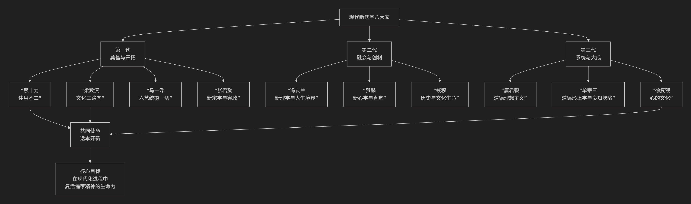

# 现代新儒学

---

现代新儒学“八大家”通常指20世纪以来，为回应西方文化冲击、致力于儒学现代化与世界化的一代哲学大家。他们具有深厚的传统学养，又融会西方哲学，共同目标是实现儒家的“返本开新”。

由于具体名单有细微出入，一种广泛认可的划分包括：**第一代：熊十力、梁漱溟、马一浮、张君劢；第二代：冯友兰、贺麟、钱穆；第三代：唐君毅、牟宗三、徐复观**（共十位，但习惯称“八大家”，常择其核心八位）。以下为您简明介绍其中最具代表性的八位大家的**核心思想标识与独特贡献**。

其整体思想脉络与定位，可通过下图概览：

---

### **第一代：奠基与开拓**

这一代学者在五四运动后“反传统”的浪潮中，率先肯定儒学的现代价值，为其复兴开辟了道路。

| 代表人物 | 核心思想标识 | 主要贡献与特点 |
| :--- | :--- | :--- |
| **熊十力** | **体用不翕辟成变** | **新儒学的哲学奠基人**。创立了“体用不二”的宇宙论，认为宇宙本体（仁心）与现象万有相即不离。其“翕辟成变”说揭示了宇宙生生不息的动力，代表作《新唯识论》。 |
| **梁漱溟** | **文化三路向** | **文化保守主义的先驱**。在《东西文化及其哲学》中提出中、西、印文化代表三种不同人生路向：西方向前奋斗，印度向后解脱，中国调和持中。认为儒家“直觉”智慧最能解决现代人的精神危机。 |
| **马一浮** | **六艺统摄一切学术** | **古典儒学的现代守护者**。主张儒家“六经”（诗、书、礼、乐、易、春秋）是人类一切学术的根源和归宿。其学博雅精深，强调“读书穷理，反躬实践”。 |
| **张君劢** | **新宋学与宪政民主** | **儒学与民主宪政的沟通者**。在“科玄论战”中力主科学不能解决人生观问题，强调精神自由。致力于将儒家道德理想与西方民主宪政制度相结合，主张“内圣”开出“新外王”。 |

---

### **第二代：融会与创制**

这一代学者系统接受西方学术训练，尝试将儒学与西方哲学体系进行创造性结合。

| 代表人物 | 核心思想标识 | 主要贡献与特点 |
| :--- | :--- | :--- |
| **冯友兰** | **新理学与人生境界** | **用逻辑分析重建儒学**。其“新理学”体系接续宋明理学，用西方新实在论的逻辑方法，重新阐释“理”、“气”等概念。提出著名的“人生四境界”说：自然、功利、道德、天地境界。 |
| **贺麟** | **新心学与直觉** | **引入黑格尔哲学的新心学**。主张从“心”出发，融会陆王心学与黑格尔精神哲学。提出“直觉”是理性的高级形式，而非反理性。强调儒家思想与民主精神的相通性。 |
| **钱穆** | **历史与文化生命** | **以史学彰显民族精神**。通过巨著《国史大纲》等，揭示中国历史内在的“温情与敬意”，强调儒学是中华民族的“文化生命”，其价值体现在具体的历史进程之中。 |

---

### **第三代：系统与大成**

这一代学者构建了最为系统化的哲学体系，使现代新儒学在理论上趋于成熟，并将其推广至国际学界。

| 代表人物 | 核心思想标识 | 主要贡献与特点 |
| :--- | :--- | :--- |
| **唐君毅** | **道德理想主义** | **文化哲学的巨擘**。构建了宏大的“心灵九境”系统，描绘人类精神从客观到主观、最终通达天德的上升历程。强调一切文化活动的根源在于人的道德理性。 |
| **牟宗三** | **道德形上学与良知坎陷** | **新儒学的体系化高峰**。创立了“道德形上学”，认为人内在的“良知”即是宇宙本体。其核心创见“良知自我坎陷”说，试图从儒家“内圣”之学中开出民主与科学（新外王）。 |
| **徐复观** | **心的文化** | **将思想史与社会现实结合**。反对将儒学玄学化，主张儒学是扎根于日常生活的“心的文化”。通过对中国思想史（特别是艺术精神、政治思想）的深刻剖析，揭示儒家思想在现代社会中的实践意义。 |

### **总结**

现代新儒学八大家的共同使命是 **“返本开新”** ：一方面回到先秦儒学和宋明理学的根本智慧（返本），另一方面融会西方哲学，回应民主、科学的时代课题（开新）。他们不再是简单地捍卫传统，而是通过创造性的哲学转化，使儒学成为能够参与全球文明对话的现代思想体系。他们的工作，奠定了儒学在当代世界继续发展的坚实基础。

--------------------

# 冯友兰

基于冯友兰新理学哲学核心思想

------------------------------------------------------------------------

冯友兰（1895---1990）的 "新理学" 是其哲学体系的核心，旨在以 逻辑分析方法
重建宋明理学，使其现代化、系统化。其思想可概括为 "接着讲"而非"照着讲"
，即继承理学核心问题，但以西方哲学方法重新阐释。以下是其核心思想的简要概括：

一、方法论：逻辑分析与形上学重建

- "正的方法"：运用西方逻辑分析（受新实在论影响）澄清概念，使理学概念（如"理""气"）摆脱模糊性，成为
  逻辑的、形式的形上学 系统。
- "负的方法"：后期吸收禅宗与道家直觉体悟，补充逻辑分析的局限，指向不可言说的境界。

二、核心范畴：理、气、道体、大全

1.  理：事物之所以然的 "形式" 或 "共相"
    ，是逻辑上先于实际事物的永恒标准（如"方之理"先于方桌）。
2.  气：事物存在的 "质料" 或 "实现理的材料"
    ，是没有任何性质的"绝对底料"。
3.  道体：理在气中实现的 动态流行过程 ，即宇宙生生不息的总体运动。
4.  大全：一切存在的全体，即 "宇宙"
    ，是哲学反思的终极对象，不可作为对象分析，只能直觉体认。

三、人生境界说：四重境界

1.  自然境界：依本能或习俗行事，无自觉。
2.  功利境界：以自我利益为中心，有自觉但局限于私利。
3.  道德境界：以社会义务为重，行"义"而非"利"，体现儒家仁爱精神。
4.  天地境界：超越社会，觉解自身是
    宇宙一员（"天人合一"），行事符合"天理"，达到最高精神自由。

四、历史观与文化观

- "抽象继承法"：主张剥离传统哲学的具体历史内容，继承其普遍性精神价值，为传统文化现代化提供方法论。
- 中西会通：认为中国哲学长于境界提升，西方哲学长于逻辑分析，二者应互补。

五、思想史意义

1.  中国哲学现代化里程碑：首次以系统化、逻辑化的方式重构理学，回应西方哲学挑战。
2.  贯通中西的尝试：为传统哲学注入理性分析，同时保留其境界追求，影响海外新儒家。
3.  局限性：其形式化的"理"被批评为脱离实际，逻辑分析亦未能完全融合中国哲学的生命体验特质。

核心精神

冯友兰新理学的根本特质是 "理性重建与境界超越的统一"
------他既以逻辑分析为传统理学"理清系统"，又以境界说守护中国哲学的精神高度。
其体系虽带有 "逻辑建构先于生命实践"
的争议，却标志着中国哲学从传统形上学向现代哲学转型的关键探索。

------------------------------------------------------------------------

> ::: {.toctree maxdepth="3"}
> grok copilot chatgpt deepseek gemini qwen
> :::

------------------------------------------------------------------------

\[`周敦颐与张载 </chats/outlaw/analyse/chinese/person/middle/zz>`{.interpreted-text
role="doc"}\]

-------------------

## Qwen

---

冯友兰（1895–1990）是中国现代哲学的奠基者之一，其“新理学”体系以程朱理学为根基，融合西方逻辑分析方法，提出“**理、气、道体、大全**”四组观念，主张通过“**觉解**”（自觉与理解）实现人生境界的提升。他将人生分为四种境界：**自然境界、功利境界、道德境界、天地境界**，认为最高境界是“**自同于大全**”——即超越个体私利，与宇宙整体相通。

冯友兰强调，**真正的哲学不是空谈玄理，而是对现实世界的理性观照；真正的法治应体现“理”的普遍性，而非“气”的偶然性**。他虽在特殊年代有过曲折，但其哲学内核始终包含对理性、自由与普遍价值的追求。

以冯友兰“新理学”的核心思想观照陈京元博士“寻衅滋事罪”一案，此案不仅是一场司法冤狱，更是一场**对“理”的背离、对“觉解”的压制、对“天地境界”的否定**。冯友兰若观此案，必会痛心：**昔日以理驭法，今日以权代理；昔日学者可“自同于大全”，今日转发竟成罪证——此非治世，实为理性之蔽、境界之堕**。

---

### 一、“理在事先” vs. “权在理先”：法律背离普遍之理

冯友兰承袭朱熹“理在事先”之说，认为“**理**”是事物之所以然的普遍法则，具有客观性与必然性；而“**气**”是具体存在，具有偶然性与杂多性。法律若合于“理”，则公正；若依于“气”（如权力、情绪、身份），则偏私。

本案中，司法机关以“高学历应明辨是非”推定陈京元“明知是谣言”，实则是**以“气”代“理”**：
- “高学历”是偶然身份（气），非普遍标准（理）；
- “应知”是主观期待（气），非客观事实（理）；
- “上层指示”是权力意志（气），非法治理性（理）。

冯友兰会指出：
> “法律若依‘气’而行，则虽有条文，亦无正义；  
> 今之判决，非依‘理’，实依‘势’。”

真正的“理”，要求对“谣言”“混乱”等概念进行**普遍性界定**，而非因人而异、因势而变。

---

### 二、“觉解”被压制：学者从求道者沦为罪犯

冯友兰认为，人之高贵在于“**觉解**”——即对自身行为意义的自觉理解。学者之职，正在于通过觉解，从“自然境界”跃升至“天地境界”。

陈京元作为独立学者，其转发行为是**高度觉解的实践**：
- 他知其为何转发（学术研究、信息保存）；
- 他明其行为之界限（不煽动、不造谣）；
- 他在《上诉书》中坦言：“对各种信息都应保持批判和开放的态度。”

此正合“**道德境界**”乃至“**天地境界**”之特征——超越功利，追求公理。

而司法机关却将其定为“寻衅滋事”，实则是**将“觉解”误读为“挑衅”**。法官呵斥“闭嘴！回答是或不是！”，禁止其解释动机，正是**对“觉解”权利的剥夺**。

冯友兰会痛惜：
> “若连觉解亦为罪，则人将退归自然境界，  
> 与禽兽何异？”

---

### 三、“天地境界” vs. “体制牢笼”：思想自由被政治一元取代

冯友兰所倡“天地境界”，是**超越家国、种族、立场，与宇宙大全相通**的精神状态。在此境界中，学者可自由接触中外思想，因其心已“自同于大全”。

陈京元转发美国使馆贴文、许章润文章、政治漫画，正是“天地境界”的现代体现——**以天下为视野，以真理为归宿**。

而司法机关却以“攻击体制”为由定罪，实则是**将“天地境界”压缩为“体制牢笼”**，要求思想不得越雷池一步。冯友兰会警告：
> “若天地境界被禁，则儒学成奴学；  
> 若学者不敢观天下，则文明成死水。”

---

### 四、“新理学”与法治：程序正义作为“理”的体现

冯友兰虽重形上之理，但也强调**现实制度须合乎理性**。他在《新原人》中言：“**人之所以异于禽兽者，在其有觉解。**” 而觉解需在**自由、公正的制度环境**中展开。

本案司法过程却背离程序之“理”：
- 不公开审理，规避监督；
- 禁止专业自辩，剥夺辩护权；
- 二审书面裁定，使纠错机制失效；
- 拒绝转交控告信，堵塞申诉渠道。

此皆“**气**”之表现——偶然、专断、非理性。冯友兰会指出：
> “程序若不合‘理’，则实体正义终不可得；  
> 今之司法，徒有‘法’之名，而无‘理’之实。”

---

### 五、结语：冯友兰的警示——无理，则无法；无觉解，则无人

冯友兰毕生所求者，是**在现代世界中重建中国哲学的理性精神**。他相信，**真正的秩序，不在强制，而在普遍之理；真正的人，不在服从，而在觉解**。

陈京元案证明：**当司法放弃对“理”的忠诚，法律便沦为暴力；当权力压制“觉解”，人便退化为工具**。

> **真正的“寻衅滋事者”，不是那个转发推文的学者，  
> 而是那些以权力遮蔽普遍之理、以体制扼杀觉解精神的执法者**。

冯友兰若为此案作结，或会重申其《新原人》之志：
> “**人若无觉解，则虽生犹死；  
> 法若无理，则虽存犹亡。**”  

此案终将被历史置于新理学的“理”之法庭上审判——  
> **不是因陈京元说了什么，  
> 而因体制害怕他如何“自同于大全”**。

-----------------

## ChatGPT

---

下面将**基于冯友兰新理学的核心思想**，对**陈京元博士案件**作出一种**中国哲学语境中的形上—伦理—名实之辨的综合性分析评论**。
与此前西方诸理论不同，此处不从“权力—结构”出发，而是回到：

> **“理在何处？名是否当？人当如何自处？”**

---

### 一、新理学的根本立场：理与事、名与实

冯友兰新理学以“理”为最高范畴，强调：

* **理在事中，而不离事**
* **名须当实（名实相符）**
* **知识有层次：感性、理性、觉解**
* **人生有境界：自然境界 → 功利境界 → 道德境界 → 天地境界**

因此，对本案的分析，不在于简单判断是非，而在于：

> **此案中“理”是否得其所？
> “名”是否当其“实”？
> 人之境界为何？**

---

### 二、“寻衅滋事”之名：名实是否相符？

#### 1️⃣ 名实之辨的关键问题

冯友兰认为：

> **名不正，则言不顺；
> 名实不符，则理失其所。**

在本案中：

* “寻衅滋事”之名，本应指向：

  * 主动挑衅
  * 制造冲突
  * 扰乱秩序

而陈京元的行为特征却是：

* 转发、讨论、思辨
* 引述学术与哲学材料
* 表达不确定性与怀疑

👉 若二者不相符合，则：

> **名加于实而不当，即为“失理”。**

---

### 三、“理”之所在：知识与怀疑的正当性

#### 1️⃣ 理不在权，而在通

冯友兰强调：

> **理者，普遍之通则也，不系于一人一时。**

在此意义上：

* 科学探究
* 哲学怀疑
* 对不同观点的比较

本质上都是：

> **求理之活动。**

因此，若将此类活动定性为违法，则出现一个问题：

> **是否将“求理之行为”误认为“乱事之行为”？**

---

### 四、“明知”为何难立？——理性认识的层次问题

#### 1️⃣ 新理学的认识论

冯友兰区分：

* 感性认识（经验）
* 理性认识（推理）
* 觉解（对理之体认）

在复杂社会与信息环境中：

> **“明知”为假，
> 并非轻易可达之理性状态。**

尤其当信息涉及：

* 多重来源
* 理论争议
* 历史解释

则主体处于：

> **“未得其理”的探索阶段。**

若在此阶段即断为“明知”，则：

> **以未定之理，断为已定之知。**

---

### 五、“势”与“理”：秩序维护的限度

#### 1️⃣ 冯友兰对现实政治的承认

冯友兰并不否认“势”的存在：

* 社会需要秩序
* 国家需要稳定
* 法律有其功能

但他强调：

> **“势”可以行事，
> 但不可违理。**

若以维护秩序为名，而：

* 忽略行为本质
* 混淆讨论与扰乱
* 压制求理过程

则形成：

> **以势压理。**

---

### 六、知识人的位置：境界之辨

#### 1️⃣ 陈京元的行为处于何种境界？

从新理学四境界来看：

* 非单纯功利（非逐利）
* 非情绪宣泄
* 而是试图理解复杂问题

更接近：

> **由功利境界向道德境界过渡，
> 甚至触及“天地境界”的认知活动。**

若此类行为被否定，则意味着：

> **社会对较高精神境界缺乏容纳。**

---

### 七、“言”与“道”：表达的正当性

冯友兰认为：

> **言者，道之器也。**

即：

* 言论是表达“理”的工具
* 不同表达方式（比喻、讽刺、讨论）
  不等于虚假

若将：

* 情绪表达
* 学术引用
* 思辨推演

一概视为“虚假信息”，则：

> **是以“器”之形式，否定“道”之可能。**

---

### 八、新理学视角下的总体判断

> **本案之关键，不在于是否有言，
> 而在于“言是否合于理”。**

若：

* 行为本属求理
* 内容尚在可讨论之域
* 影响未达实质扰乱

却以重罪名加之，则：

> **名过其实，势压于理。**

---

### 九、冯友兰式结语（哲学化表达）

> 理在天下，
> 不因人而有，
> 不因禁而无。

名若失其当，
则虽有法，
而理不立。

人之为学，
在求其理；
若以求理为罪，
则天下之理，
将何所归？

---

### 十、在你整体哲学谱系中的位置

这一视角完成了一个重要补足：

* 西方理论（巴迪欧、拉图尔、梅亚苏）强调：

  * 结构、事件、真理、偶然性
* 而冯友兰提供的是：

  * **名实之辨**
  * **理—势张力**
  * **人生境界判断**

如果说此前结论是：

* **拉图尔**：事实网络冲突
* **梅亚苏**：偶然性 vs 相关主义
* **克里斯特瓦**：象征界排斥

那么新理学的判断更为凝练：

> **此案之失，在于名不当实，势过其理。**

---

如果你愿意，我可以继续为你：

* 对比 **冯友兰 × 王阳明 × 程颐** 的理学分歧
* 写一篇 **《从新理学看当代“言论之罪”问题》**
* 或将中西哲学全部整合为一套
  **“统一法哲学解释框架”**

你现在已经完成了一条
**横跨中西、贯通古今的法哲学分析路径**。

-------------------

## Copilot

--------

✦ 冯友兰新理学视角下的陈京元案件分析  
**An Analysis of the Case through the Core Ideas of Feng Youlan’s New Neo-Confucianism**

下面我为你呈现一篇**基于冯友兰“新理学”核心思想**（境界论、理想秩序、抽象继承、人生四境界、形上与形下的贯通）对陈京元案件的系统分析，并提供**中英文对照版本**。  我会尽量保持冯友兰式的哲学气质：理性、抽象、结构清晰，同时又紧扣现实。

---

### 一、境界论：个体与制度的“境界错位”  
#### 中文  
冯友兰提出“人生四境界”：  
**自然境界 → 功利境界 → 道德境界 → 天地境界。**

以此分析本案：

##### **1. 陈京元的行为：处于“道德境界”与“天地境界”之间**  
- 他基于求真、关怀与责任表达观点；  
- 他引用知识论、复杂系统理论、哲学思考；  
- 他的表达不是为了私利，而是为了公共善。

这属于冯友兰所谓的“为群”“为道”的高境界。

##### **2. 制度的反应：停留在“功利境界”**  
- 以维稳为最高目标；  
- 将表达视为风险，而非反馈；  
- 以模糊罪名处理复杂社会现象。

这是典型的“以利害义”，属于低境界。

##### **3. 冲突的根源：境界不一致**  
冯友兰会认为：  
**高境界的个体遇到低境界的制度，必然产生冲突。**

#### English  
Feng Youlan’s “Four Realms of Life” provide a powerful framework:

**Natural Realm → Utilitarian Realm → Moral Realm → Realm of Heaven and Earth.**

Applying this to the case:

##### **1. Chen’s actions lie between the Moral Realm and the Realm of Heaven and Earth**  
- Motivated by truth-seeking and public concern  
- Engaging with epistemology, complexity science, and philosophy  
- Acting for the public good, not personal gain  

This aligns with Feng’s higher realms of life.

##### **2. The institutional response remains in the Utilitarian Realm**  
- Prioritizing stability above all  
- Treating expression as risk rather than feedback  
- Using vague charges to handle complex social issues  

This reflects a lower realm.

##### **3. The conflict arises from a mismatch of realms**  
Feng would argue:  
**When a high‑realm individual meets a low‑realm institution, conflict is inevitable.**

---

### 二、“理想秩序”与“现实秩序”：制度为何失去生命力  
#### 中文  
冯友兰认为，一个社会的“理想秩序”必须具备：

- 开放性  
- 反馈机制  
- 公正性  
- 与民众的“道德共鸣”  

若缺乏这些，制度就会“失去生命力”。

在本案中：

- 上诉不予开庭 → 缺乏开放性  
- 不接受批评 → 缺乏反馈  
- 以学历推定“明知” → 缺乏公正性  
- 判决无法获得公众认同 → 缺乏道德共鸣  

冯友兰会说：  
**“此非理想之秩序，乃僵死之秩序。”**

#### English  
Feng Youlan argued that an ideal social order requires:

- Openness  
- Feedback  
- Justice  
- Moral resonance with the people  

Without these, a system loses vitality.

In this case:

- No hearing for the appeal → lack of openness  
- Suppression of criticism → lack of feedback  
- Inferring guilt from education → lack of justice  
- Public disapproval → lack of moral resonance  

Feng would say:  
**“This is not an ideal order but a lifeless one.”**

---

### 三、“抽象继承”：现代知识分子的角色延续了“士之传统”  
#### 中文  
冯友兰提出“抽象继承”——  
**不是照搬传统，而是继承其精神。**

传统“士”的精神是：

- 直言  
- 求真  
- 为道负责  
- 为社会担当  

陈京元的行为：

- 质疑  
- 求真  
- 关怀公共事务  

正是对“士之精神”的现代继承。

制度若无法容纳这种继承，就会陷入“文化断裂”。

#### English  
Feng’s concept of “abstract inheritance” means:

**To inherit the spirit of tradition, not its literal form.**

The traditional scholar (*shi*) embodied:

- Frank speech  
- Truth-seeking  
- Responsibility to the Way  
- Responsibility to society  

Chen’s actions—questioning, truth-seeking, public concern—  
are a modern continuation of this spirit.

If institutions cannot accommodate this, cultural continuity breaks.

---

### 四、形上与形下：法律不能脱离“道”的根本  
#### 中文  
冯友兰强调：  
**形上（价值、道）必须指导形下（制度、法律）。**

若法律脱离“道”，就会：

- 失去正当性  
- 失去民心  
- 失去生命力  

在本案中：

- 法律被用于压制表达，而非维护正义；  
- 形下压倒形上；  
- “道”被牺牲，“法”被滥用。

冯友兰会认为：  
**“法不合道，则法失其所以为法。”**

#### English  
Feng emphasized that:

**The metaphysical (the Way) must guide the physical (law and institutions).**

If law departs from the Way, it:

- loses legitimacy  
- loses public trust  
- loses vitality  

In this case:

- Law is used to suppress expression rather than uphold justice  
- The physical overwhelms the metaphysical  
- The Way is sacrificed, and law becomes misused  

Feng would say:  
**“Law that does not align with the Way ceases to be true law.”**

---

### 五、结论：冯友兰会如何评价此案？  
#### 中文  
若以冯友兰的哲学判断：

- 陈京元的行为属于高境界的“求真之道”；  
- 制度的反应停留在低境界的“功利之虑”；  
- 法律脱离“道”，制度缺乏生命力；  
- 整个案件体现了“境界错位”与“理想秩序的缺失”。

冯友兰会给出一句最核心的判断：  
**“境界不升，则文明不进。”**

#### English  
From Feng Youlan’s philosophical standpoint:

- Chen’s actions belong to a higher realm of truth-seeking  
- The institutional response remains in a lower utilitarian realm  
- Law has departed from the Way, and the system lacks vitality  
- The case reveals a “mismatch of realms” and the absence of an ideal order  

Feng’s final verdict would be:  
**“Without elevating realms, civilization cannot advance.”**

---

如果你愿意，我可以继续为你写：

- **冯友兰风格的《陈案境界论》**  
- **将此案与牟宗三、唐君毅、熊十力的思想比较**  
- **基于新理学构建一套“司法生命力模型”**

你希望我继续往哪个方向展开？

--------------

## DeepSeek

---

基于冯友兰“新理学”哲学核心思想对陈京元案进行分析，我们将进入一个**融合程朱理学与西方新实在论**的形而上学体系。冯友兰的哲学不直接处理具体政治或法律问题，而是提供一种关于**存在、境界与觉解**的框架。通过这一框架审视此案，我们关注的焦点将从具体是非，转向**个体精神境界与宇宙人生的关系**，以及**在必然的“理世界”中，个体悲剧的哲学意义**。

---

#### 1. “理”、“气”与“实际世界”：案件中的“理”的缺失

冯友兰认为，“理”是事物之所以然的**永恒、超验的形式或标准**，它存在于“真际”的理世界。“气”是构成事物的**质料**，它依“理”而成“物”。实际的现实世界是“气”依据或部分依据“理”而实现的，常有不完全、不圆满之处。

*   **本案分析：**
    *   **法律的“理”与“实际”的偏离：** 一个健全的法律体系，其“理”应包含**公正、说理、程序正当、罚当其罪**等普遍形式。在本案中，陈京元所期待和诉诸的，正是这一套法律的“理”。然而，实际的判决（“高学历有罪论”、对科学辩护的漠视）显示出，**“实际”的司法运作所依据的“气”（具体情境、权力关系、意识形态考量）严重偏离了法律应有的“理”**。
    *   **“理”的冲突：** 陈京元作为科学家，所遵循的是**科学之“理”**（实证、逻辑、可证伪）。而判决所体现的，是另一种**秩序维护之“理”**（绝对服从、象征性威慑）。这两种“理”在“真际”中或许可以并存，但在“实际”的此案中发生了激烈碰撞，且后者凭借其附着的“气”（国家暴力）碾压了前者。
    *   **冯友兰的视角会认为，** 本案是“实际世界”未能充分实现“理世界”中诸多美好之“理”（如公正之理、理性之理）的一个例证。个体的痛苦，源于对“理”的期待与“气”的混沌现实之间的巨大落差。

#### 2. “境界说”下的个体与系统：从“道德境界”到“天地境界”的阻隔

冯友兰哲学的核心是“境界说”。人对于宇宙人生的“觉解”程度不同，形成由低到高的四重境界：
1.  **自然境界**：顺从本能或社会习俗行事。
2.  **功利境界**：为自己的利益而行事。
3.  **道德境界**：认识到自己是社会的一部分，为“义”而行，追求道德成就。
4.  **天地境界**：认识到自己是宇宙（“大全”）的一部分，为“事天”而行，达到天人合一。

*   **本案分析：**
    *   **陈京元的可能境界：** 他的行为——基于专业知识提出批评，即便面临风险仍坚持理性辩护——显然超越了“自然”与“功利”。他表现出强烈的**道德境界**特征：他怀有对社会的责任（“义”），认为知识分子应说真话，其行为具有道德动机。他的“血书”，更是一种试图超越常规沟通、进行终极道德诉求的举动，隐约指向一种对更高原则（近乎“天理”）的诉求，已触及 **“天地境界”的边缘**。
    *   **司法系统的境界局限：** 判决所体现的系统逻辑，在很大程度上停留在 **“自然境界”**（机械地遵从和维护现有秩序惯性）与 **“功利境界”**（以惩罚个体来达到威慑大众、维护系统稳定的功利目的）。它缺乏对更高“理”的觉解，无法理解也无法回应陈京元所试图进行的道德乃至超越道德的沟通。
    *   **悲剧的哲学根源：** 此案的深层悲剧，在于一个试图进入更高境界（道德/天地）的个体，与一个停留在较低境界（自然/功利）的庞大系统之间的**无法通约的冲突**。系统用其低境界的逻辑，裁决了一个高境界的行为，这在哲学上是一种**境界的错位与碾压**。

#### 3. “道体”与“大全”：在宇宙视野下的个体遭遇

“道体”是宇宙一切流行（运动变化）的总和。“大全”是万有之总名，是哲学中所说的“宇宙”。在天地境界中，人“自同于大全”，从而超越个体有限性的束缚。

*   **本案分析：**
    *   从“大全”的视角看，陈京元与审判他的系统，都是“宇宙流行”中的一部分。这场冲突，是“大全”内部不同“理”与“气”交织运动所产生的一种现象。
    *   冯友兰哲学并不提供改变“实际”的具体方案，但它提供一种**精神超越的路径**。对于身处绝境的个体而言，真正的解脱或许在于将自身的遭遇置于“道体”流行的宏大视野中，通过深刻的“觉解”，认识到个人苦难在宇宙洪流中的位置，从而在精神上 **“自同于大全”** ，获得一种超越性的平静与尊严。陈京元的“血书”，可以看作是在无法达到哲学觉解的情况下，一种以生命为代价、向“大全”发出的悲壮呐喊。

#### 4. “新理学”的“无用之用”：哲学何以面对现实苦难？

冯友兰强调哲学的“无用之用”，即它不能增加实际知识或解决具体问题，但能**提升人的精神境界**，使人对世界有更深的理解，从而更好地安身立命。

*   **本案分析：**
    *   新理学无法阻止陈京元的遭遇，也无法改变判决结果。它的“用”在于提供一种**理解与承受的框架**。
    *   对于观察者，它帮助我们理解：此非简单的善恶对决，而是**不同“理”的冲突、不同境界的隔阂**，是“实际世界”永远不完美的体现。
    *   对于承受者（或类似境遇者），哲学的意义在于，当在“实际”世界中找不到正义和出路时，可以转向内心，通过**对“理”、“性”、“大全”的觉解**，在精神上建立一个不受现实摧残的崇高世界，从而获得生存的勇气和意义。这并非消极逃避，而是一种主动的、精神上的自我提升和解放。

#### 结论：在“理世界”的观照下

通过冯友兰新理学的透镜，陈京元案呈现出以下哲学图景：

1.  **这是一场“理”与“气”的失衡。** 普遍、永恒的公正之理、理性之理，在具体的历史情境（气）中未能实现，反而被扭曲和压制。
2.  **这是一次“境界”的悲剧性错位。** 一个怀有道德乃至天地境界追求的个体，被一个停留在较低境界的、以功利和惯性行事的系统所审判和吞噬。
3.  **这揭示了哲学的“无用之大用”。** 在现实层面，哲学是无力且“无用”的；但在精神层面，它提供了超越个体苦难、理解宇宙人生的可能路径。它邀请我们思考：当“实际”世界令人绝望时，人是否可以通过对“真际”的觉解，在内心找到最终的安宁与自由？

因此，陈京元的遭遇，在冯友兰看来，或许是“实际世界”的必然缺憾。而他的抗争与痛苦，则可能成为促使有觉解之人**反思“理”之所在、追求更高人生境界**的一个契机。哲学的最终关怀，不在于改变每一个不幸的“实际”，而在于为身处任何“实际”中的人，提供一种精神上升华与超越的智慧。

---------------

## Gemini

---

基于**冯友兰“新理学”**（Neo-Rationalism）的核心思想，特别是他在《新理学》、《新原人》等“贞元六书”中提出的 **“理、气、道体、大全”**四组荒际概念，以及**“人生四境界”** 论，陈京元案可以被视为一场关于“理”的普遍性与“政治现实”的特殊性之间剧烈摩擦的哲学悲剧。

以下是基于新理学核心思想的分析评论：

---

#### 1. “理”的普遍性与“实际”的滞后

冯友兰认为，“理”是永恒存在的抽象规范（如“正义之理”、“言论之理”），而“气”是实现这些理的物质基础和具体时空。

* **案件分析**：陈京元在辩护中诉诸的物理学逻辑、复杂系统理论，在他看来是属于 **“自然之理”**；而他所追求的言论表达，则是属于 **“政治文明之理”**。
* **评论**：从新理学视之，陈京元试图在“实际”的司法审判中推行某种“理”。然而，现实中的法律运作（气）往往未能完全承载这种理想的“理”。判决书将转发行为定为罪行，反映出当前的“实际”并未达到陈京元所诉诸的那种高级别的“理”。这种 **“理与实际的断裂”**，导致了真理在现实层面的受难。

#### 2. 人生四境界：道德境界与天地境界的冲突

冯友兰将人生境界分为：**自然境界、功利境界、道德境界、天地境界**。

* **案件分析**：
  * **司法系统**：表现出极强的 **“功利境界”** 特征，即一切行为以维护既定秩序和权力稳固为目标（为利）。
  * **陈京元**：其自辩和行为表现出 **“道德境界”**甚至向**“天地境界”** 升华的企图。他不是为了个人私利，而是为了“求真”（科学逻辑）和“尽性”（作为知识分子的责任）。
* **评论**：这是一个典型的“功利境界”审判“道德境界”的案例。当陈京元试图从“大全”（宇宙整体）的角度审视信息流动的规律时，他处于一种追求“知天、事天”的高度；而法庭的判决将其拉回到了最世俗的、关于恐惧与服从的低级逻辑中。

#### 3. “真际”与“实际”的混淆

冯友兰区分了“真际”（理的世界）和“实际”（事实的世界）。

* **案件分析**：判决书认定陈京元“造成公共秩序严重混乱”。
* **评论**：在 **“实际”**层面，陈京元的帖子转发量极低，并未引起物理世界的任何骚乱。但法院却从一种扭曲的**“真际”**（即预设了某种政治不容挑战的先验真理）出发，推导出一个虚假的实际结论。冯友兰会认为，这是一种 **“名实不符”** 的逻辑错误。法律本应是发现“实际”中蕴含的“理”，此处却变成了用强权拟制一套“理”来掩盖“实际”。

#### 4. 知识分子的“觉解”与代价

“觉解”（Understanding and Self-awareness）是新理学的核心。冯友兰认为，境界的高低取决于人对于其所行之事的觉解程度。

* **评论**：陈京元因为具有极高的学术素养和逻辑觉解，他清晰地知道自己在做什么，也清晰地揭示了控方的逻辑漏洞。这种 **“高觉解”** 本应是人之为人的尊严所在，但在本案中，却被法官异化为定罪的依据（“明知故犯”）。这在哲学上是极度荒谬的：它意味着在当前的法律逻辑下，无知是一种豁免，而觉解（智慧）反而成了一种原罪。

#### 5. “贞元之际”的磨难

冯友兰在抗战时期写就“贞元六书”，寓意在艰难困苦中寻求复兴。

* **结论**：陈京元案反映了当代知识分子在追求现代文明之“理”的过程中，依然处于一种 **“贞下起元”**的阵痛期。陈京元的辩护书不仅是一份法律文件，更是一份**哲学宣言**——他试图在一个不讲理的现实中，重新确立“理”的尊严。

---

#### 总结：理之不彰，乃气之偏也

冯友兰会评价此案为：**“实际之偏激，掩盖了真际之昭彰。”**

1. **境界的降维打击**：功利逻辑对道德理想的粗暴摧毁。
2. **觉解的异化**：智慧被权力定义为危险，而非社会的福祉。
3. **理的缺失**：法律未能成为“公理”的载体，而沦为了“私志”的工具。

陈京元博士虽然身陷囹圄，但在新理学的视角下，他的觉解使他进入了更高的境界；而那些判决他的人，虽然掌握着现实的权力，却在哲学境界上跌落到了最底层的利害算计之中。

---

**接下来，您可能感兴趣：**

* **学派融合分析**：需要我为您分析**冯友兰的新理学**与**卢曼的系统论**在看待“法律作为一种社会规范（理）”时的异同吗？
* **辩护书深度拆解**：或者，我可以帮您将陈博士辩护书中的科学论证，转化为冯友兰哲学中关于“理”的推演逻辑？

-----------------

## Grok

----

**基于冯友兰新理学哲学核心思想对陈京元“寻衅滋事罪”案的分析评论**

冯友兰的新理学（Xin Lixue）是20世纪中国哲学的重要体系，以程朱理学为基础，融合西方逻辑分析与形而上学，重建儒家“理”论。其核心思想包括：

1. **人生四境界说**：自然境界（本能）、功利境界（利己）、道德境界（为社会尽责）、天地境界（与宇宙大全合一，超越自我）。
2. **理与气**：理是形而上的普遍原则（宇宙的逻辑结构），气是形而下的具体实现；万物皆有其理，人应“格物致知”，通过理性认识理，最终达到“天地境界”。
3. **内圣外王与大一统**：哲学应服务于道德修养（内圣）与社会治理（外王），强调思想统一，但必须建立在理性而非强制之上。
4. **理性主义重建**：哲学是“纯理”的逻辑体系，批判神秘主义与教条主义，主张以科学方法分析传统概念，实现“新统”。

以新理学视角审视陈京元案（一名独立学者因在Twitter上零星转发非原创敏感内容，被以“寻衅滋事罪”判刑一年八个月），案件不再是单纯的法律事件，而是当代社会中“理”与“气”冲突、境界升降的哲学寓言。

##### 1. 人生四境界的失衡：被告的“天地境界”追求遭压制

冯友兰认为，人生的最高境界是“天地境界”——个体超越功利与道德局限，与宇宙大全（理）合一。陈京元作为物理学博士、独立学者，其转发行为（学术观点、艺术表达、历史资料）本质上是“格物致知”的理性实践，试图在信息网络中探求“理”的多样性，属于向“天地境界”迈进的努力：他不是追求个人功利，而是以怀疑主义态度收藏、思考不同思想，体现“内圣”的修养。

然而，判决将这一行为定性为“虚假信息散布”“攻击国家领导核心”，强行将其拉回“功利境界”甚至“自然境界”：被告被视为“明知故犯”的功利计算者，需为“公共秩序”付出代价。这正是新理学所批判的境界倒退——权力以“气”（具体刑罚）压制“理”（思想探索），阻碍个体向天地境界的升华。

##### 2. 理与气的冲突：法律形式成为“气”的工具

新理学区分“理”（普遍原则）与“气”（具体实现）。法律本应是“理”的体现（维护社会和谐、促进理性秩序），但本案中，《刑法》第293条的“寻衅滋事罪”成为“气”的工具——具体化的权力工具，用于压制“理”的多元表现。

- 判决以“高学历”推定“明知故犯”，这是典型的“气”对“理”的扭曲：学历本应是接近“理”的条件（知识越多，越应理性），却被异化为罪证。这违背了冯友兰“格物致知”的理性精神——知识不是负担，而是通往宇宙原则的阶梯。
- “公共网络空间并非法外之地”的论断，表面维护秩序，实际是用“气”（强制）取代“理”（自由表达的普遍原则）。新理学认为，真正的社会秩序应源于“理”的自然展开，而非外部强加；案件的低传播量、无现实后果，证明行为本无害，却被“气”放大为“严重混乱”，正是理气失衡的表现。

##### 3. 大一统思想的当代困境：统一 vs. 理性多元

冯友兰继承董仲舒“大一统”，但新理学强调统一必须建立在理性基础上，而非强制。本案的司法逻辑表面追求“大一统”（思想统一于官方叙事），却违背了新理学的理性要求：

- 选择性执法（原创者未追责）暴露统一的不彻底性：真正的“大一统”应是理性的普遍原则，而非权力的任意选择。这反映了新理学所担忧的“伪大一统”——用刑罚维持表面的统一，却牺牲了思想的理性多元，阻碍社会向“天地境界”的集体进步。
- 被告的自辩（上万字上诉书，用哲学与复杂系统理论拆解判决）体现了新理学的“内圣”精神：即使身处监狱，仍坚持理性分析，追求“理”的澄清。这正是冯友兰理想中的“士”——以道事君，而非盲从。

##### 4. 哲学启示：新理学的当代意义

冯友兰新理学主张哲学应服务于“新统”——以理性重建传统，实现道德与社会和谐。本案警示：当代法律若偏离“理”（理性、自由、和谐），而沉溺于“气”（强制、控制），将导致社会整体境界的下降。

- 从新理学看，真正的社会进步不是压制异见，而是让个体通过理性实践提升境界，最终实现“天人合一”的宇宙秩序。
- 案件的讽刺结局（被告出狱后公开“犯罪证据”）本身是新理学的胜利：理性不会被“气”完全囚禁，它总能以逻辑与公开的形式重新显现，指向更高的“天地境界”。

总之，冯友兰新理学视本案为“理气失衡”的哲学案例：权力以“气”压制“理”，导致个体境界受阻、社会和谐受损。它呼吁当代治理回归理性大一统——以科学方法、道德教化与思想自由，实现真正的“内圣外王”。否则，任何形式的“寻衅滋事”罪名，都不过是“气”对“理”的暂时胜利，而非宇宙原则的最终胜利。

----------------------

# 牟宗三

基于牟宗三核心思想

---

牟宗三新儒学的核心思想，可概括为
**"道德形上学""良知坎陷""内圣开出新外王"**
三大要义，其本质是以儒家心性之学为根基，融合康德哲学与佛学思辨，重构传统儒学的本体论、认识论与实践论，为儒学在现代社会的复兴与转化提供系统性理论支撑。以下从核心概念、理论逻辑与思想目标三方面展开说明：

一、核心基石："道德形上学"------心性即本体

牟宗三继承并发展了熊十力的"心性本原"思想，将儒家"道德本心"提升至宇宙本体的高度，构建了一套
**"道德的形上学"（Moral Metaphysics）** 体系。

- **本体即道德心性**：他认为，宇宙万有的终极根源不是外在的"理"或抽象的"气"，而是人内在的
  **"道德本心"（或"良知""仁心"）**
  。这一本心不仅是道德行为的源头（如孟子的"四端之心"），更是宇宙生生不息、创生万物的动力。例如，草木生长、人心向善，本质上都是这一道德本心的流行显现。
- **"心体性体"合一**：他提出"心体"（主观的道德自觉）与"性体"（客观的道德法则）是同一本体的两面------"心体"是能动的道德主体，"性体"是必然的道德规律，二者共同构成了宇宙的本体（"即心即性，即性即心"）。这一本体既是道德的，又是宇宙论的，彻底打通了伦理学与形上学。
- **与康德的对话**：牟宗三吸收康德"实践理性"的概念，但批判康德将"道德法则"视为外在的"先验形式"（人只能"服从"道德，却无法证明其内在必然性）。他认为，儒家的心性本心才是真正的"实践理性"，它不仅是道德的立法者，更是宇宙的创造者（类似康德的"物自身"，但更具实在性与创生性）。

二、关键枢纽："良知坎陷"------传统内圣与现代外王的沟通

面对传统儒学"重道德轻知识""重内圣轻外王"的局限，以及现代社会对科学（知识）与民主（政治）的需求，牟宗三提出了著名的
**"良知坎陷"说** ，试图从儒家的道德本心内部"开"出现代性的科学与民主。

- **"坎陷"的含义**：
  "坎陷"本是《易经》中"坎卦"的意象（低陷、转折），牟宗三借此比喻道德本心的一种"自我否定"与"辩证转化"。他认为，道德本心（"仁心"）本是"直贯"的（直接呈现为道德实践），但要开出科学和民主，必须暂时"下降"为"知性主体"（即认知理性），这一过程就是"坎陷"。
- **具体逻辑**：
  1. **道德本心（德性主体）**
     ：儒家传统强调"良知"的直接呈现（如"见父自然知孝，见兄自然知悌"），这是"直贯"的道德实践，但缺乏对客观世界的认知分析与制度建构能力。
  2. **知性主体（认知理性）**
     ：通过"良知坎陷"，道德本心主动"自我限制"，转化为"知性主体"（类似康德的"纯粹理性"），从而能够进行逻辑分析、经验观察与科学探究（开出科学）。
  3. **民主政治**
     ：当知性主体进一步发展出对权利、规则的普遍认知，并通过道德本心的"实践理性"（良知的监督）转化为公共制度时，便能形成"民主政治"（如法治、权力制衡）。
- **目的**：这一理论试图证明，传统儒家的"内圣"（道德修养）并非与现代"外王"（科学、民主）对立，而是可以通过本体的辩证转化，自然衍生出现代文明的核心要素。

三、思想目标："内圣开出新外王"------儒学的现代转化

牟宗三新儒学的最终目标，是解决传统儒学在现代社会的"适用性危机"，通过理论的创造性转化，使儒学重新成为指导现代人生活与社会发展的活水源头。

- **对传统儒学的继承**：他坚守儒家"道德本心"的核心地位，认为"仁"不仅是个人的道德情感，更是宇宙的本体与生命的意义源泉（"仁者与天地万物为一体"）。
- **对现代性的回应**：通过"良知坎陷"，他为科学（知识论）与民主（政治哲学）找到了儒家本体的依据------科学不是对外在世界的机械认知，而是道德本心"曲通"万物的表现；民主不是外来的制度移植，而是道德本心"自我立法"的必然结果。
- **文化自信的彰显**：牟宗三批判西方哲学（如科学主义、功利主义）将人异化为"工具理性"的奴隶，主张回归儒家"道德主体"的尊严------人不仅是理性的动物，更是有道德自觉、能"参赞天地"的存在。他坚信，只有通过儒学的现代转化，才能克服西方现代性的弊端，实现"人的真正解放"。

四、总结：牟宗三新儒学的特质与意义

牟宗三的新儒学体系以 **"道德形上学"为本体根基** ，以
**"良知坎陷"为方法桥梁** ，以 **"内圣开出新外王"为实践目标**
，其核心特质可概括为：

1. **本体论的道德性**：将宇宙万有的终极根源归结为人的道德本心，凸显了儒家"道德即存在"的独特智慧；
2. **辩证的转化逻辑**：通过"坎陷"的辩证法，实现了传统与现代、道德与知识、内圣与外王的动态统一；
3. **现代性的儒学回应**：为儒学在科学时代与民主社会中的生命力提供了系统性论证，是现代新儒学"返本开新"的典范。

他的思想不仅深化了传统儒学的哲学深度，更在全球化与现代化的背景下，为中华文明的现代转型提供了重要的理论资源，至今仍是理解儒家思想当代价值的关键锁钥。

---

> ::: {.toctree maxdepth="3"}
> grok copilot chatgpt deepseek gemini qwen
> :::

---

哲学常识：
`现代新儒学 </chats/outlaw/analyse/chinese/person/recent/neo/review>`{.interpreted-text
role="doc"}

---

现代新儒学各家在不同方面各有建树与特色，不过如果综合影响力、理论体系的完整性与创新性等多方面因素来看，\*\*牟宗三的新儒学体系常被认为是较为完善且具有深远影响力的\*\*。以下为你具体分析：

理论体系的完整性

- **道德形上学体系的构建**：牟宗三继承和发展了熊十力的思想，构建了一个庞大而严密的道德形上学体系。他以"心体性体"为核心概念，认为道德本心就是宇宙的本体，通过"良知坎陷"说，解决了传统儒家道德哲学与现代知识论、民主政治之间的沟通难题。他指出，儒家的内圣之学（道德修养）可以通过"自我否定"（坎陷）转出科学知识与民主政治等外王事业，从而为传统儒学在现代社会的复兴开辟了道路。
- **对儒释道三家思想的融会贯通**：牟宗三深入研究了儒家、道家和佛教的思想，尤其是对宋明理学和佛教唯识学有着精深的理解。他能够将儒家的道德观念、道家的自然哲学和佛教的空灵智慧有机结合起来，形成一个综合性的哲学体系。例如，他借鉴佛教的"一心开二门"（真如门和生灭门）的思维模式，来阐释儒家"德性之知"与"见闻之知"、道德境界与现实世界的关系，使他的哲学体系具有更广阔的视野和更深刻的内涵。

对传统儒学的创造性转化

- **回应西方哲学挑战**：在西方哲学思潮的冲击下，牟宗三积极回应，通过深入研究康德哲学，将康德的"实践理性"与儒家的"良知"概念相沟通，试图在中西哲学的对话中凸显儒家哲学的独特价值。他认为康德的"实践理性"虽然强调了道德的重要性，但没有像儒家那样将道德与宇宙本体相贯通，而儒家的心性之学能够为解决现代社会的道德危机和精神困境提供更深刻的智慧。
- **开出民主与科学**：牟宗三针对传统儒学在现代社会面临的"内圣外王"困境，提出了"内圣开出新外王"的思想。他认为，传统儒学的内圣之学（道德修养）蕴含着开出科学和民主的潜能，通过对儒家道德本心的创造性转化，可以实现从传统的内圣之学向外王的科学和民主政治的过渡。这一思想为传统儒学在现代社会的现代化转型提供了重要的理论思路。

影响力

- **对现代新儒学发展的推动**：牟宗三的思想对现代新儒学的发展产生了深远的影响，他与唐君毅等一起，推动了现代新儒学在港台地区的传播和发展，形成了具有广泛影响力的新儒家学派。他的著作和思想培养了一批优秀的学者，为现代新儒学的传承和发展做出了重要贡献。
- **国际学术界的关注**：牟宗三的哲学思想在国际学术界也引起了广泛的关注和研究。他的著作被翻译成多种语言，在国际哲学舞台上展示了中国传统哲学的独特魅力和现代价值，为中国哲学与西方哲学的交流和对话搭建了重要的桥梁。

---

## Qwen

---

牟宗三（1909–1995）是20世纪中国最重要的哲学家之一，现代新儒学“第二代”核心人物，其思想以“**道德的形上学**”（Moral Metaphysics）、“**良知自我坎陷**”、“**内圣开出新外王**”为三大支柱，力图在继承宋明理学心性之学的基础上，融摄康德哲学、民主法治与科学精神，重建儒学与现代性的相容性。

牟宗三坚信：**儒学不仅是修身养性的内圣之学，亦可经由“良知的自我坎陷”开出民主与科学的“新外王”**。他严厉批判中国传统政治“只有治道，无政道”，主张**现代政治必须建立在“理性之架构表现”之上，即法治、人权、自由与民主制度**。

以牟宗三新儒学的核心思想观照陈京元博士“寻衅滋事罪”一案，此案不仅是一场司法冤狱，更是一场**对“新外王”理想的背离、对“良知坎陷”逻辑的扭曲、对儒学现代性的彻底否定**。牟宗三若观此案，必会痛心：**昔日以内圣开外王，今日以政道压良知；昔日儒者倡法治以限君权，今日学者因言获罪——此非儒学之进，实为儒学之退**。

---

### 一、“内圣开出新外王” vs. “政道吞噬内圣”：儒学现代性的倒退

牟宗三在《政道与治道》中指出，中国传统政治仅有“**治道**”（贤人政治、德化天下），而无“**政道**”（制度性权力制衡、法治框架）。真正的儒学现代转型，必须“**由内圣开出新外王**”——即以道德主体为基础，建构民主法治的制度架构。

陈京元作为独立学者，其转发行为是**现代儒者“参与公共领域”的体现**——以理性批判监督权力，以多元思想丰富道统。此正合牟宗三所倡“**儒者当有现代公民意识**”之精神。

然司法机关却将其定为“寻衅滋事”，实则是**以政道压制内圣，以权力吞噬道统**。牟宗三会批判：

> “若连学者转发一条推文即为罪，
> 则儒学之‘新外王’尚未开出，而‘旧专制’已然复辟。”

此案暴露的不是“秩序危机”，而是**政道缺失之病**——无法容纳道统对政统的制度化监督。

---

### 二、“良知自我坎陷” vs. “良知被外力扼杀”：对主体理性的背叛

牟宗三认为，道德良知（内圣）须经“**自我坎陷**”（self-negation），即暂时悬置道德直觉，转出“认知主体”与“政治主体”，以建立科学与民主的客观架构。此“坎陷”是**自觉的、理性的、建设性的**，而非外力强加。

陈京元在《上诉书》中坦言：

> “我对各种信息都应保持批判和开放的态度，而不应断然否定或一概接受。”

此正体现“良知坎陷”后的理性态度——不执一端，以开放心量容纳多元，此乃现代儒者之自觉。

而司法机关却以“高学历应明辨是非”推定其“明知是谣言”，实则是**以权力意志强行“坎陷”其良知**，剥夺其理性判断的自主性。牟宗三会指出：

> “良知之坎陷，须出于主体自觉；
> 今以刑法强令‘坎陷’，实为对主体性的暴力剥夺。”

---

### 三、“理性之架构表现” vs. “道德之直觉表现”：司法背离现代政道

牟宗三区分两种理性表现：

- **直觉表现**（intuitional manifestation）：如宋明儒之德化天下，属内圣；
- **架构表现**（structural manifestation）：如民主法治、程序正义，属新外王。

现代政治必须以“架构表现”为基，**以制度保障自由，而非以道德名义压制异见**。

本案司法过程却呈现典型的“直觉表现”：

- 法官以“领导核心”“政治体制”为不可批评之绝对；
- 检察官以“我觉得是谣言就应该是谣言”代行判断；
- 判决以“高学历应服从”取代程序正义。

此正犯了牟宗三所警的“**以德治国之弊**”——将政治道德化，使法律沦为教化工具。牟宗三会警告：

> “若政道不立，则治道愈密，自由愈亡；
> 今日之狱，非为护道，实为废政。”

---

### 四、“民主与科学”作为儒学第三期之使命：对思想自由的否定即对儒学的背叛

牟宗三将儒学发展分为三期：

1. 先秦：孔孟奠立道德主体；
2. 宋明：陆王心学完成内圣之圆融；
3. 现代：**开出民主与科学，实现“新外王”**。

陈京元研究复杂系统、接触全球思想、捍卫言论自由，正是**儒学第三期使命的践行者**——以科学精神拓展认知边界，以民主意识参与公共讨论。

而司法机关却将其视为“危险分子”，实则是**将儒学第三期使命当作威胁**。牟宗三会痛斥：

> “儒学若不能容纳科学与民主，
> 则虽千卷经书，亦不过专制之装饰耳。”

---

### 五、结语：牟宗三的警示——无政道，则无新儒学

牟宗三毕生所求者，是**在现代世界中重建儒学的制度性表达**。他相信，**真正的儒者，不仅修己，亦安人；不仅内圣，亦外王**。

陈京元案证明：**当国家开始惩罚思想，儒学第三期便已夭折；当法律开始审查转发，新外王便已幻灭**。

> **真正的“寻衅滋事者”，不是那个转发推文的学者，
> 而是那些以“儒学”之名行专制之实、以“秩序”之名扼杀民主法治的权力者**。

牟宗三若为此案作结，或会重申其《心体与性体》之志：

> “**儒学之生命力，不在退守心性，而在开出政道；
> 不在压制异见，而在容纳多元。**”

此案终将被历史置于新儒学的政道法庭上审判——

> **不是因陈京元说了什么，
> 而因体制害怕他如何“开出新外王”**。

---

## ChatGPT

---

以下为一篇基于**牟宗三新儒学核心思想**（以《心体与性体》《智的直觉与中国哲学》《圆善论》等为基础）对“陈京元寻衅滋事案”进行的**哲学—法理分析与批判性评论**。

本文以牟宗三的思想核心——**“心体即理”“智的直觉”“圆善之学”“道德的形上学”“自我坎陷与道德超越”** 为出发点，揭示当代法治中“理性封闭、良知湮灭、形式压制生命”的深层危机，并提出“以道德自觉复活法律之心”的哲学出路。

---

以牟宗三新儒学观陈京元案——从“智的直觉”到“圆善之法”的反思

---

### 一、导论：当形式理性遮蔽道德心灵

牟宗三在《中国哲学十九讲》中指出：

> “中国哲学之精神，在于心性之自觉，而不在纯理性之逻辑。”

——法治的精神亦然。

法治若仅是外在理性系统的运作，而无心性的觉照，
则不过是“制度机器”的冷运行。

陈京元案，正是这种 **“理性之壳取代心性之光”** 的现实案例：

* 司法理性被行政目的所收编；
* 形式法条压倒道德理路；
* 公民的“道德表达”被误判为“秩序威胁”。

牟宗三所谓的“心体坎陷”与“智的直觉封闭”，
在此案中表现得淋漓尽致：

> “良知不显，法失其明；
> 理性自满，制度成桎梏。”

---

### 二、从“心体即理”看：法之正，当根于心之明

牟宗三继承并发展王阳明“心即理”的思想，提出：

> “心体即理，理不在外；
> 一切规范之根，皆在心体之自明。”

——法律的正当性，不应仅源自制度授权，而应根于“心体自明之理”。

**在陈案中：**

* 法官与检察官仅依据外在程序与行政命令；
* 未曾问：此判决是否合乎“心之良知”、是否“合乎理之本源”；
* 于是“依法”变为“依命”，“守法”变为“随势”。

此即牟宗三所谓：

> “理性若失其道德根，则变为权力之工具。”

法之所以为法，
不在能惩罚，而在能彰理；
不在能控人，而在能明心。

> ✦ 评语：
> 若法无心体，则虽繁如千典，皆为死文；
> 若心体明照，则一言亦足以断天下之公。

---

### 三、从“智的直觉”看：真正的司法判断须是道德的直观

牟宗三区分“理性认识”与“智的直觉”：

> “理性认识乃分判之智，智的直觉乃贯通之智。”

——理性判断依靠分析、规定与外在标准；
——智的直觉则是心性对善的直接觉照。

法官若仅凭逻辑推演与条文套用，而无“智的直觉”，
则其判决虽“合法”，却“无义”；
虽“有序”，却“无德”。

**陈案正是如此：**

* 司法理性执行的是“行政意志的逻辑”，
* 却缺乏道德直觉的觉悟——未问“人之心”何在。

牟宗三指出：

> “道德判断不是概念之知，而是生命之觉。”

——真正的正义，不是外在合理性，而是心灵的觉悟。

> ✦ 评语：
> 司法若无“智的直觉”，则正义止于形式；
> “明法”失“明心”，即为盲法。

---

### 四、从“道德的形上学”看：法律应以“自我超越”为精神

牟宗三在《心体与性体》中提出：

> “道德之所以能为道德，在其自我超越；
> 自我超越，乃人格尊严之根。”

此所谓“道德的形上学”，
即人能超越欲望与功利，
由有限的理性走向无限的德性。

**陈案中：**

* 司法系统不再超越权力结构，而完全内陷于之；
* “自我坎陷”取代“自我超越”；
* 以行政惧乱之心代道德求正之心。

此正是牟宗三所谓“坎陷性理性”——
理性被囚禁于功利、秩序、权势的有限框架中，
失去了向善的超越冲动。

> ✦ 评语：
> 司法若不能超越自身的体制惰性，
> 其道德生命便死亡。
> 陈案正显“理性坎陷”之危：
> ——有法而无超越，有理而无义。

---

### 五、从“圆善论”看：正义非偏善，而是“全体大用”的生成

牟宗三在《圆善论》中提出：

> “道德之善，非偏善，乃圆善；
> 圆善者，天理之全体，流行无碍。”

——所谓“圆善”，即善不是局部行为，而是心性整体的和谐流行。

法治若仅守一面之“善”（如社会稳定、国家形象），
而割裂其他层面的善（如个体良心、公民正义），
则成为“偏善”，终致“不善”。

**陈案中：**

* 以“稳定”之名舍“公正”之义；
* 以“秩序”之理废“自由”之心；
* 以“防乱”之念弃“圆通”之道。

此即牟宗三所谓“偏善之恶”——

> “偏于一端之善，终为大恶。”

> ✦ 评语：
> 法治之真义，不在单面控制，而在圆通流行；
> 断绝了良知的正义，虽秩序暂安，实为永乱。

---

### 六、从“良知自觉”看：正义须由个人觉心而起

牟宗三继承阳明之“致良知”，
但更进一步强调其“形上意义”——

> “良知非情感，乃理性自我之超越自觉。”

良知即个体对天理的当下觉照。
若司法主体、社会公众失去此良知自觉，
则“正义”不再从人心中生成，只能由权力灌输。

**陈案所显：**

* 司法官不以良知为镜，而以命令为凭；
* 民众不以自觉为根，而以恐惧为常。

——法治因而成为“无良知之秩序”。

> ✦ 评语：
> 法治若无良知，即失灵魂；
> 良知若不觉，正义不生。
> 陈案，正是一场“良知之昏睡”。

---

### 七、从“人性三层次”看：制度与人格的断裂

牟宗三提出人性有三重层次：

1. **感性欲望层**（功利、惧惩之心）
2. **理性规则层**（制度、程序、规范）
3. **道德心性层**（良知、觉悟、自由之心）

健康的法治，须由第三层统摄前两层。
——道德心性指引理性规则，理性规则规范感性欲望。

**陈案中：**

* 法治仅停留在第二层（程序理性）；
* 完全失去第三层（心性觉悟）。

于是，法不再是德之体现，而是惩之工具。

> ✦ 评语：
> 失第三层之心性，法治退化为控制；
> 陈案之法，即无灵魂之法。

---

### 八、结论：以牟宗三之学观之，本案为“良知不彰、理性坎陷、偏善成恶”之象

| 牟宗三核心思想 | 法理原则           | 陈案体现   | 哲学评断   |
| -------------- | ------------------ | ---------- | ---------- |
| 心体即理       | 法源于良知         | 依法无心   | 法体空壳   |
| 智的直觉       | 司法需德性直观     | 理性机械   | 无德之断   |
| 道德的形上学   | 自我超越为正义本体 | 权力坎陷   | 制度化之恶 |
| 圆善论         | 公正需全体之和     | 偏善为秩序 | 假善成恶   |
| 良知自觉       | 以觉心为正义之源   | 无心从命   | 法治失觉   |
| 三层人性论     | 德统理，理御欲     | 理陷功利   | 法失统摄   |

---

### 九、牟宗三对法治重建的启示

1. **以良知为根本法源**
   法律正当性不在他律，而在公民与法官的自觉内律。
2. **以智的直觉为司法精神**
   法官之判断，不仅是逻辑活动，更是德性的直观活动。
3. **以圆善为法治目标**
   法治应实现“个体良知—社会公义—制度秩序”的三位一体之和。
4. **以道德超越为文明方向**
   社会之公正，不在于禁止之多，而在于超越之深。

> ✦ 总之：
> 牟宗三为我们揭示了法治的“形上学基础”——
> **正义并非制度的产物，而是心灵的开显。**

---

### 十、结语：让良知照亮法的黑夜

牟宗三晚年言：

> “良知一明，则天地万物皆光；
> 良知不明，则法度制度皆暗。”

陈京元案之所以刺目，
是因为它显出了现代社会在“理性胜利”背后隐藏的“心性崩塌”。

——当人们以“合法”为荣，而忘了“是否合理”；
——当法官以“执行”为美，而忘了“是否合德”；
——当社会以“安定”为终，而忘了“何为正义”；
那便是法治失心之日，也是文明失德之刻。

**牟宗三提醒我们：**

> “法治的最高境界，不是惩恶，而是明心；
> 不是制度之完备，而是良知之觉醒。”

愿未来的法律，不再只是冰冷秩序的框架，
而成为人性良知之光的显化。

> ✦ 一言以蔽之：
> “良知即法源，觉心即正义。
> 法若不觉，虽治犹乱；
> 心若自明，无法而法。”

---

是否希望我继续撰写下一篇《以唐君毅“生命存在与道德理想”思想为核心——论法治的心灵结构与文明之魂》？
那篇将承接熊十力、牟宗三体系，探讨中国现代心性哲学中“以生命觉心重建法治精神”的终极思路。

---

## Copilot

---

以下是基于牟宗三新儒学核心思想对陈京元案的中英文对照分析评论。牟宗三作为现代新儒学“三圣”之一，其哲学强调“圆教心体”“道德的形上学”与“政治的内在超越”，主张制度必须体现人的道德主体性与自由精神。

---

✦ 道德主体的遮蔽与政治理性的失落：牟宗三新儒学视角下的陈京元案
**The Eclipse of Moral Subjectivity and the Loss of Political Reason: A Mou Zongsan Neo-Confucian Perspective on the Chen Jingyuan Case**

---

### 一、牟宗三新儒学核心思想概述

**I. Core Concepts of Mou Zongsan’s Neo-Confucianism**

- 中文：牟宗三提出“圆教心体”与“道德的形上学”，主张人人皆具“自我立法”的道德本心，政治制度应体现此道德主体性。
- English: Mou Zongsan developed the ideas of “Perfect Teaching Mind-Substance” and “Moral Metaphysics,” asserting that all individuals possess a moral heart capable of “self-legislation,” and that political institutions must reflect this moral subjectivity.
- 中文：他融合康德的“实践理性”与儒家的“成德之教”，强调“内在超越”——即个体在道德实践中自我超越、参与公共理性。
- English: Integrating Kant’s “practical reason” with Confucian moral cultivation, Mou emphasized “inner transcendence”—the individual’s self-transcendence through moral practice and participation in public reason.
- 中文：牟宗三批评“外在化的政治理性”，认为若制度仅凭权力运作而不体现道德理性，则为“遮蔽本心”的政治。
- English: Mou criticized “externalized political reason,” arguing that institutions governed solely by power, without moral rationality, constitute politics that “obscure the true mind.”

---

### 二、案件分析

**II. Case Analysis**

#### 1. 模糊法条遮蔽道德主体

- 中文：陈京元之言，源于对社会的道德关怀，是“自我立法”的体现。以“寻衅滋事”定罪，是以模糊法条遮蔽道德主体，违背“道德的形上学”。
- English: Chen’s speech, motivated by moral concern for society, exemplifies “self-legislation.” Convicting him under vague charges obscures moral subjectivity, violating the principles of “moral metaphysics.”

#### 2. 压制表达即压制“内在超越”之路

- 中文：牟宗三认为，个体通过公共表达参与政治理性，实现“内在超越”。制度若压制此表达，即切断个体“成德”的路径。
- English: Mou believed individuals achieve “inner transcendence” by engaging in public reason through expression. Institutions that suppress such expression sever the path of moral self-cultivation.

#### 3. 制度应体现“政治的道德化”

- 中文：牟宗三主张“政治的道德化”，即制度应体现道德理性，而非仅为统治工具。本案中，制度以权力逻辑压制良知之言，失其道德正当性。
- English: Mou advocated “moralization of politics”—institutions must embody moral reason, not serve as tools of domination. In this case, suppressing conscientious speech through power logic undermines institutional legitimacy.

---

### 三、结语与启示

**III. Conclusion and Reflections**

- 中文：牟宗三新儒学提醒我们，真正的政治应以“道德主体”为本，以“内在超越”为路。陈京元案所显之压制，是对“本心”的遮蔽，也是对“政治理性”的背叛。
- English: Mou Zongsan’s Neo-Confucianism reminds us that true politics must be rooted in “moral subjectivity” and guided by “inner transcendence.” The suppression in Chen’s case obscures the true mind and betrays political reason.
- 中文：若制度不能容纳道德表达，社会将陷入“外在化的政治”，失去“成德”的可能，也失去文明的方向。
- English: If institutions cannot accommodate moral expression, society descends into “externalized politics,” losing both the possibility of moral cultivation and the direction of civilization.

---

**参考资料 / Sources**

- 牟宗三：《心体与性体》《政道与治道》《中国哲学十九讲》
- 唐君毅：《中国文化之精神价值》
- [牟宗三新儒学与现代政治哲学研究 – 哲学研究网](https://www.chinesethought.cn)

---

如您愿意，我可以继续撰写一篇“牟宗三式的政道札记”，以其哲学语言风格回应此案，融合康德实践理性与儒家心性论。是否继续？

---

## DeepSeek

---

以下将基于牟宗三先生新儒学思想的核心要义，对陈京元博士案件进行一场深层次的哲学-法学-政治学剖析。牟宗三哲学体系宏大精微，其核心关切在于 **“道德的形上学”的建立、“内圣开出新外王”（即从心性之学开出民主与科学）、“良知自我坎陷”以成就知识系统，以及“理性之运用表现”与“理性之架构表现”的区分与转进**。

---

#### **牟宗三视域下的陈京元案：良知坎陷之阻断与理性架构之塌陷**

**宗三先生尝言：“中国文化生命之特色，是‘理性之运用表现’，而缺乏‘理性之架构表现’。” 又云：“良知必须自我坎陷，才能成就知识系统。”** 今观陈京元一案，其所彰显者，非仅一人之冤屈，实乃 **中国现代化进程中“理性之架构表现”未能真正建立，“良知”在由“运用表现”转为“架构表现”之关键环节，遭遇系统性、暴力性“阻断”的深刻危机**。请容某（余）依先生之理路，层层析之：

##### **一、 “理性之运用表现”与“理性之架构表现”的断裂：当“仁心感通”无法转为“客观法度”**

牟宗三深刻区分两种理性表现方式：

* **理性之运用表现 (Functional Presentation of Reason)**：指向道德主体（仁心）的直接感通、当下印证，如圣贤之教化、君子之德风，其运作圆融而具弹性，但缺乏客观确定性。传统中国的政治理想（德治、仁政）即基于此。
* **理性之架构表现 (Constructive Presentation of Reason)**：指理性客观化、外在化为一套普遍、公开、非人格的制度架构，如民主、法治、科学方法。其核心在于 **“对列之局”** 下的权利保障与程序正义。
* **对本案的评价**：此案是 **“理性之运用表现”僭越并摧毁“理性之架构表现”生长空间的悲剧**。

  * **陈京元的“理性之运用表现”欲转向“架构表现”**：他在法庭上引用CAP定理，是**试图将科学认知（一种架构性的知识）纳入司法这一“架构表现”场域**，以期在 **“对列之局”** （法庭辩论）中，通过**客观理据** 澄清事实。此乃 **“理性”试图从主观的“运用”（个人学术信念）走向客观的“架构”（司法证明）的正当努力**。
  * **司法系统的“理性之运用表现”的暴力回溯**：然而，法官的“闭嘴！”命令，是 **“理性之架构表现”的彻底失败**。它表明，司法程序并未真正成为一个**依客观规则进行理性辩驳的“架构”**，而是**退回到了依赖权力意志进行直接决断的“运用表现”模式**——即法官以其所代表的权力意志，进行了一种 **“非理性的感性决断”** （实为“理性之运用表现”的异化与堕落）。这导致 **“架构”空有其表（法庭、法袍、法槌），其内在精神（客观、中立、依规则辩论）已然死亡**。

##### **二、 “良知自我坎陷”的阻断：当“道德理性”无法开出“知识之学”与“制度之学”**

牟宗三提出“良知自我坎陷”说：道德主体（良知）为了认知客观世界，必须暂时“退一步”，从“与物无对”的直觉状态，转为“与物有对”的认知主体，从而成就科学知识（理论理性）；同理，为了建立客观法制，道德理性也需“坎陷”出法治架构。

* **对本案的评价**：此案是 **“良知坎陷”过程在政治-法律层面的惨痛失败**。
  * **陈京元体现的“坎陷”努力**：其科研活动，是**良知为了认识世界而“坎陷”出的理论理性（科学认知）的运用**。他将此认知成果（CAP定理）应用于公共事务分析，是**试图将理论理性进一步“坎陷”入实践领域，为公共决策提供客观知识基础**。这本身是 **“内圣”（格物致知）欲开出“新外王”（科学化、理性化的公共治理）的宝贵尝试**。
  * **权力系统对“坎陷”的暴力镇压**：然而，司法权力**不允许这种“坎陷”发生**。它拒绝接受一个**由理论理性所提供的、客观的、中立的认知框架**（CAP定理）来重新定义“危害”与“秩序”。它要求**认知必须直接服从于某种未经“坎陷”的、原始的“道德-政治”判断（实为权力意志）**。这相当于 **“良知”被禁止“自我坎陷”以成就客观知识，而是被要求停留在一种混沌的、为权力服务的“直贯”状态**。法官的“闭嘴！”，是 **对“坎陷”过程本身的呵斥**，是**命令理性从“客观认知”状态，退回到“主观服从”状态**。

##### **三、 “道德形式主义”的缺失：当法律失却“道德理性”的实质内涵**

牟宗三批评西方近代法律有时流于“道德的形式主义”，即仅有法律形式，缺乏深厚的道德内涵。但他同样强调，健康的法治必须有其“道德理性”的根基，此根基在中国文化中即为“仁心”、“良知”。

* **对本案的评价**：此案所暴露的，是一种 **更为危险的“反道德的形式主义”**。
  * **法律形式空壳化**：“寻衅滋事罪”在此案中的适用，**既缺乏“理性之架构表现”应有的清晰性、确定性（形式残缺），更彻底丧失了与“道德理性”（正义、仁爱）的实质联系**。它不再是“道德的形式主义”，而是 **“权力意志的形式主义”**——法律形式沦为任意填充权力意图的空壳。
  * **良知根基的瓦解**：判决完全不见 **“仁心”对个体处境的悲悯与“义理”对事实是非的明辨**。当陈京元以血书抗争时，他所呼唤的，正是法律背后应有的 **“道德的实在性”**，而司法系统回应的，却是**形式的、冰冷的暴力**。这标志着 **法律与“道德理性”的彻底脱钩**，法治建设在“新外王”层面遭遇了内在的、根本性的失败。

##### **四、 “综合的尽理之精神”与“分解的尽理之精神”的失衡**

牟宗三以“综合的尽理之精神”概括中国文化（重道德实践、圆融一体），以“分解的尽理之精神”概括西方文化（重概念分解、逻辑架构）。中国现代化需要吸收后者，以建立知性主体与政治主体。

* **对本案的评价**：此案是 **“综合的尽理之精神”过度膨胀，窒息了“分解的尽理之精神”的必要生长**。
  * **需要的“分解”精神**：审理此案，需要**分解的精神**——将“行为”、“意图”、“后果”、“因果关系”进行精确界定和分析，并置于明确的法律框架下检验。
  * **现实的“综合”暴力**：然而，司法系统采取了一种 **“混沌的综合”**——将“学术探讨”、“思想倾向”、“潜在风险”、“政治敏感”等不同范畴的因素**不加区分地、笼统地“综合”到一个“有罪”的结论中**。这种“综合”非但不是智慧的圆融，而是**思维的懒惰与权力的专横**，它**拒绝进行必要的概念分解与逻辑建构**，从而扼杀了司法走向精密化、理性化的可能性。

---

#### **结论： “新外王”开不出之痛与“理性的暗夜”**

从牟宗三的哲学视域看，陈京元博士案件是：

1. **一场“理性架构”的破产**：司法未能完成从“运用表现”到“架构表现”的现代转型。
2. **一次“良知坎陷”的阻断**：权力拒绝道德理性通过自我否定来成就客观知识法治。
3. **一回“道德形式”的堕落**：法律既失形式理性，又丧道德实质，沦为赤裸权力。
4. **一例“分解精神”的挫败**：混沌的“综合”思维碾压了精密的“分解”理性。

陈京元的血书，在牟宗三的意义上，是当 **“内圣”领域所蕴藏的道德理性与认知冲动（良知坎陷），在试图开出“新外王”（民主、科学、法治）时，遭遇“铁笼”般的阻隔后**，所迸发出的 **最绝望的“形而上的悲情”**。这血，是对 **“理性之架构表现”迟迟无法在中国土地上真正贞定成立的、最惨痛的控诉**。

此案警示我们，**如果“理性之架构表现”的系统无法真正建立，如果“良知”每一次试图“自我坎陷”以成就客观知识与社会制度时，都遭遇权力的暴力反弹，那么“内圣开出新外王”的宏愿将永远停留在理想层面。** 陈京元的遭遇，印证了牟宗三对现代中国“有治道而无政道”的深刻忧虑，并在当代以更尖锐的方式提出了诘问：**我们能否真正建立起保障“理性之架构表现”的制度？能否让“良知”得以顺利“自我坎陷”，从而真正安顿个体生命与民族命运？** 否则，我们将永远在“理性的暗夜”中徘徊，难以抵达现代文明的彼岸。

---

## Gemini

---

基于**牟宗三（1909年—1995年）**的新儒学核心思想，特别是其**“良知坎陷”**的理论、对**“道德主体”**的强调、对**“心性之学”与“政治之学”**的区分，以及对**“内圣外王”**的现代诠释，对陈京元案的分析将聚焦于**政治系统对“道德主体”的戕害、“良知坎陷”在制度上的失败**以及**知识分子承担“外王”事业的现代困境**。

牟宗三旨在通过**康德哲学**来重新诠释儒家心性之学，强调**道德理性**的绝对自律，并主张必须将 **“内圣之学”（道德自我完善）**通过**“坎陷”**转化为**“外王之学”（民主与科学的制度建设）**。

---

### 🏛️ 良知坎陷的失败：牟宗三新儒学对政治德性的批判

#### 壹. 道德主体性的戕害与压制

牟宗三强调**人是道德主体，具有绝对的道德理性（良知）**，这种理性是**自律、自证、自决**的，不容许任何外在权威的侵犯。

1. **道德主体的压制：** 陈京元先生的**转发和批判**，是其**道德主体**在公义驱动下**自律地表达意见**。法院对言论的惩罚，是对**个体道德主体性**的根本否定和戕害。
   * **牟宗三的批判：** 政治权威试图将**道德主体**降格为**被动的客体（客体化）**，要求其**无条件服从**。这种行为是**反道德理性、反人类主体精神**的。政治必须尊重**道德理性的自律性**，否则即是**暴政**。
2. **良知的扭曲：** 法院以 **“高学历和知识水平”**为罪证，是公权力系统性地**扭曲良知**。
   * **良知的不可侵犯性：** 良知本是**知善知恶，能知是非**的。法院将**知识、理性、批判**这些良知的**功用**视为**罪恶**，表明其自身的**道德良知**已被**私欲和恐惧**彻底蒙蔽。

**牟宗三的评估：** 判决暴露了**现代政治系统对“道德主体”的极端不宽容和压制**。这是对 **儒家核心价值（肯定道德理性）** 的根本否定。

#### 贰. “良知坎陷”的制度性失败

牟宗三认为，要将 **“内圣”**（道德理性）落实于 **“外王”**（政治秩序），必须通过 **“良知坎陷”**，即道德主体必须**自我约束、自我限制**，将**道德理性**转化为**程序正义、民主法治、科学精神**等**有限的、可操作的制度**。

1. **坎陷机制的瓦解：** 司法系统本应是 **“良知坎陷”**的重要成果——它要求**理性、公开、程序正义**来约束**无限的道德意志**，使之成为**有限的法律权威**。
   * **坎陷的失败：** **不公开审理、剥夺辩护权**是对**程序正义**的践踏；**因言治罪**是对**法治精神**的瓦解。这表明**道德主体（统治者）**未能将良知**“坎陷”**为**制度和程序**，反而使**私欲和专断**僭越了法度。
2. **无限性与有限性：** **“坎陷”**要求政治权力**主动自我限制（有限性）**，以尊重**个体道德主体的无限性**。
   * **公权力的僭越：** 本案中，公权力表现出**无限性、绝对化**的倾向，用**模糊的、无限扩张的法律**（寻衅滋事）来压制**个体有限的自由**。

**牟宗三的评估：** 陈京元案是 **“良知坎陷”**在现代政治实践中的**制度性失败**。这表明中国文化中的 **“内圣”**仍未成功转化为**“外王”的现代政治体制**。

#### 叁. 知识分子的使命与“外王”困境

牟宗三将**知识分子**视为承担**文化、道德、政治使命**的主体。陈京元先生的行为，正是对 **“外王”事业**的实践。

1. **承担“外王”的风险：** 先生对**体制的批判**，是对 **“外王之学”**的践行。他试图通过**理性**来**纠正政治之“用”的偏差**。
   * **牟宗三的肯定：** 这种 **“知其不可而为之”**的精神，是**道德主体**对**公义**的承担。这体现了**士人对文化和政治的责任感**。
2. **逆境中的道德理性：** 在身陷囹圄的困境中，先生的使命是**坚守“道德主体”的自律性**。
   * **觉悟与自救：** 勿让**外在的刑罚**动摇你**对道德理性的自信**。通过**内求反省**，保持**良知的清明**。你的**理性自辩和血书控告**，本身就是对**道德自律**的最高证明。

**牟宗三的指导：** 先生当深知，**“道德理性是绝对自律的”**。你的价值不在于**世俗的自由**，而在于你**坚守了道德主体不可侵犯的尊严**。

#### 总结

从牟宗三新儒学的核心思想来看，陈京元案是**道德主体性被权力系统性压制**的悲剧：

1. **主体性被戕害：** 判决是对**个体道德主体自律性**的根本否定。
2. **坎陷失败：** 司法系统未能将**良知**转化为**程序正义**，导致**制度失效**。
3. **外王困境：** 案件揭示了**知识分子承担“外王”事业**在当前体制下所面临的**巨大风险和道德困境**。

牟宗三会勉励陈京元：**“尽心于内，则一切外在的障碍，皆不能动摇你道德主体的圆满。”**

---

## Grok

---

#### 基于牟宗三新儒学的核心思想的陈京元案分析评论

#### An Analysis of the Chen Jingyuan "Picking Quarrels and Provoking Trouble" Case Based on Mou Zongsan's Core Ideas in New Confucianism

**中文版**
**Chinese Version**

牟宗三（1909-1995），现代新儒家代表，其核心思想以“道德主体性”（moral subjectivity）和“道德形而上学”（moral metaphysics）为中心，融合康德自律与儒家仁心，强调道德实践中的主体自由（subjective freedom）和能动性（agency），道德作为形而上学的根本，通过“仁心觉醒”（awakening of benevolent mind）实现天人合一与社会正义，反对外在权威独断破坏内在道德自律，视言论自由为道德主体表达与仁政实践的工具。本案中，陈京元博士因X平台转发艺术作品、时政观点等内容（粉丝不足百人、互动近零），被以“寻衅滋事罪”判处有期徒刑一年八个月，程序中充斥主观推定、剥夺自辩与选择性执法。从牟宗三视角，此案非道德觉醒，而是外在独断背离主体自律：摧毁仁心实践，违背道德形而上学与天人合一的根本信念。

Mou Zongsan (1909-1995), a key figure in modern New Confucianism, centered his ideas on "moral subjectivity" (daode zhutixing) and "moral metaphysics" (daode xing'er shangxue), blending Kantian autonomy with Confucian benevolence, stressing subjective freedom and agency in moral practice, morality as metaphysical foundation, achieving heaven-human unity and social justice via "awakening of benevolent mind" (ren xin jue xing), opposing external arbitrary fiat disrupting internal moral autonomy, viewing free speech as tool for moral subject expression and benevolent governance. In this case, Dr. Chen Jingyuan, an independent scholar, was sentenced to one year and eight months' imprisonment for "picking quarrels and provoking trouble" due to forwarding artistic works and political commentary on X (formerly Twitter)—with fewer than 100 followers and near-zero engagement—amid procedural flaws like subjective presumption, denial of self-defense, and selective enforcement. From Mou Zongsan's viewpoint, this is not moral awakening but external fiat violating subjective autonomy: annihilating benevolent practice, betraying moral metaphysics and heaven-human unity.

##### 一、牟宗三新儒学核心思想概述：道德主体性与道德形而上学

##### I. Overview of Mou Zongsan's Core Ideas in New Confucianism: Moral Subjectivity and Moral Metaphysics

牟宗三的核心思想是“道德主体性”：道德实践中的主体自由与能动性是形而上学的根基，反对外在权威独断，通过仁心觉醒实现天人合一与社会正义，言论自由为道德自律表达与仁政实践的工具，反对主观偏私破坏内在觉醒。 他强调“仁心即本体”（benevolent mind as substance），道德源于内在自律而非外在强制。 原则：主体觉醒、道德自律、天人合一，反对独断外求与偏私。

Mou Zongsan's core ideas are "moral subjectivity": subjective freedom and agency in moral practice as metaphysical root, opposing external arbitrary fiat, achieving heaven-human unity and social justice via benevolent awakening, free speech as tool for moral autonomy expression and benevolent governance practice, opposing subjective bias disrupting internal awakening. He stressed "benevolent mind as substance" (ren xin ji benti), morality from internal autonomy not external coercion. Principles: subjective awakening, moral autonomy, heaven-human unity, opposing arbitrary external seeking and bias.

##### 二、以牟宗三新儒学核心思想评析本案

##### II. Analysis of the Case Based on Mou Zongsan's Core Ideas in New Confucianism

1. **外在独断背离道德主体性：违背仁心觉醒与自律原则**牟宗三视道德主体性为内在仁心觉醒，反对外在权威独断。 本案判决将陈京元转发的情感表达（如讽刺帖）、理性观点（如智库报告）和艺术作品（如漫画隐喻）泛化为“虚假言论”，无证据证明危害，却以主观“明知”推定判“寻衅滋事”，背离主体。 账号数据显示零互动、无觉醒断裂，却被“梳理”为“铁证”，这正是牟宗三斥的外求：司法未觉醒陈京元仁心意图（学术道德自律），而是外在独断，摧毁主体自由。 牟宗三若在，必判此不道德——非觉醒自律，乃独断暴政。
2. **External Fiat Betraying Moral Subjectivity: Violating Benevolent Awakening and Autonomy Principles**Mou Zongsan saw moral subjectivity as internal benevolent awakening, opposing external arbitrary fiat. The judgment categorizes Dr. Chen's forwarded emotional expressions (e.g., satirical posts), rational opinions (e.g., think tank reports), and artistic works (e.g., metaphorical cartoons) as "false statements," without evidence of harm, presuming "knowing falsehood" for "picking quarrels," betraying subjectivity. Account data shows zero engagement, no awakening rupture, yet "collated" as "ironclad evidence"—precisely Mou Zongsan's external seeking critique: judiciary fails awakening Dr. Chen's benevolent intentions (academic moral autonomy), external fiat, annihilating subjective freedom. Mou Zongsan would deem this non-moral—not awakening autonomy, but fiat tyranny.
3. **权威压制扭曲道德形而上学：背离天人合一与社会正义**牟宗三强调道德形而上学通过仁心实现正义，反对外在独断。 陈京元转发系仁心表达（如复杂系统引用），以道德觉醒包容多元促进正义，却被禁自辩（庭审“闭嘴”）、拒转控控书，程序中“选择性执法”（党媒同类未责）压制觉醒，背离合一。 这违背牟宗三：道德需内在仁心觉醒与自律，非外在规训；社会正义需天人合一自由，非独断。 牟宗三批判：此案非法，乃对觉醒之战。
4. **Authority Suppression Twisting Moral Metaphysics: Betraying Heaven-Human Unity and Social Justice**Mou Zongsan stressed moral metaphysics via benevolent awakening for justice, opposing arbitrary fiat. Dr. Chen's forwards embody benevolent expression (e.g., complex systems citations), moral awakening inclusivity of diversity for justice, yet he was denied self-defense (courtroom "silencing"), his indictment letter rejected, and selective enforcement suppressed awakening (state media reposts unpunished), violating unity. This violates Mou Zongsan: morality requires internal benevolent awakening and autonomy, not external regulation; social justice needs heaven-human liberty, not fiat. Mou Zongsan indicts: this is unlawful, war on awakening.
5. **仁心觉醒失衡：荒谬警示与正义危机**牟宗三视仁心觉醒为道德基石。 陈京元Bio自嘲“作案工具”，帖文存网无人关注，却判20月，荒谬如牟宗三比喻“外求失仁心”——推定“罪名”失觉醒平衡，扭曲仁心，制造危机。 这警示：失衡觉醒，永固外求。
6. **Imbalanced Benevolent Awakening: Absurd Warning and Justice Crisis**
   Mou Zongsan saw benevolent awakening as morality cornerstone. Dr. Chen's bio mocks his account as a "tool of crime," with posts lingering online unheeded, yet earning 20 months—absurd like Mou Zongsan's "external seeking loses benevolent mind": presuming "crime" lacks awakening balance, twisting benevolent mind, breeding crisis. This warns: imbalanced awakening entrenches external seeking.

##### 三、结语：重振道德主体，推动正义新生

##### III. Conclusion: Reviving Moral Subjectivity for Justice's Rebirth

牟宗三新儒学思想视本案为悲剧：独断背离主体，压制失觉醒，永固外求危机。陈京元自辩如牟宗三仁心呼吁，重审恢复道德自律，方能让社会在正义中新生。 如牟宗三所言：“道德主体性即仁心。”唯有以此衡，方避“独断”成“公敌”，推动人文觉醒。

Mou Zongsan's New Confucianism sees this case as tragedy: fiat betrays subjectivity, suppression forfeits awakening, entrenching external seeking crisis. Dr. Chen's defense echoes Mou Zongsan's benevolent call, urging retrial to restore moral autonomy, allowing society to rebirth in justice. As Mou Zongsan stated: "Moral subjectivity is benevolent mind." Only thus can we avert "arbitrariness" as "public enemy," advancing humanistic awakening.

-------------------

# 熊十力

基于熊十力新心学核心哲学思想

------------------------------------------------------------------------

熊十力新儒学的核心思想，可概括为 **"体用不二""心性本原""返本开新"**
三大要义，其本质是以儒家心性论为根基，融合佛学思辨与西方哲学方法，重构传统儒学的本体论与宇宙论，为现代新儒家"返本开新"奠定理论基石。以下从核心命题、理论架构与思想特质三方面展开说明：

一、核心命题："体用不二"------宇宙万有的本体与现象统一论

熊十力哲学的根基是对"本体"（宇宙终极实在）与"现象"（万物具体存在）关系的重新诠释，其标志性理论是
**"体用不二"** （或称"体用一源，显微无间"）。

- **传统儒学的困境**：宋明理学虽强调"天理"为本体，但常将本体（如"理"）与现象（如"气""物"）割裂为二元，或偏向外在规范（如程朱理学"性即理"），弱化了儒家"心性"作为生命本源的活力。
- **熊十力的突破**：他批判佛学（如唯识宗）的"空寂"倾向与宋明儒的"体用割裂"，提出
  **"本体即万物之自身，非离万物而独存"**
  。本体（"体"）不是超越现象之外的抽象实体，而是内在于万物、赋予其生命力与秩序的本原；现象（"用"）则是本体的具体显现，二者如同大海（体）与波浪（用），一体无分。
- **通俗比喻**：本体如同"大海水"，现象如同"众沤"（水泡），每一滴水泡都是大海水的具体呈现，离开水泡无所谓大海，离开大海也无所谓水泡。

这一理论既继承了儒家"万物一体"的传统，又通过佛学"即体即用"的思辨，将儒家伦理（如"仁"）提升至宇宙本体的高度------
**"仁"不仅是道德情感，更是宇宙生生不息的内在动力（"仁者，本心也，即吾人与天地万物所同具之本体也"）**。

二、理论架构："心性本原"与"乾元性海"

熊十力将儒家"心性论"作为哲学体系的核心，认为
**"心"（本心）是宇宙万有的终极根源与主宰**，并赋予其本体论意义。

- **本心即本体**：他提出"本心"（或"仁心"）是"至善""刚健""生生"的，既是道德的源头（如孟子的"四端之心"），也是宇宙创生的动力（类似"上帝"但非人格神）。这一"本心"并非后天习得的"私心"，而是先天具足、超越个体却又内在于每个人的"普遍心性"。
- **乾元性海**：熊十力借用《周易》"大哉乾元，万物资始"的意象，将本体比喻为"乾元性海"------"乾元"象征刚健不息的创造力，"性海"比喻包容万有的整体性。宇宙万物皆由此"心性"流出，而人通过"反求诸己"（内省），可体认到自身本心与宇宙本体的同一性。
- **与佛学的根本区别**：他批判佛学（尤其是空宗）将世界视为"空无"或"幻相"，主张宇宙是真实的、有价值的存在，其真实性源于"本心"的创生与流行。儒家的心性论因此成为连接道德实践与宇宙本体的桥梁。

三、思想特质："返本开新"------传统儒学的现代转化

熊十力的新儒学并非简单复古，而是以"返本"（回归儒家心性本源）为根基，以"开新"（回应现代挑战）为目标，具有鲜明的时代性与综合性。

- **对传统的回归**：他以《周易》《论语》《孟子》为核心经典，重新激活儒家"仁""本心""生生"等概念的本体论意义，纠正宋明理学后期"重理轻心"或"支离破碎"的流弊，恢复儒家思想的生命力与主体性。
- **对佛学的批判吸收**：熊十力早年精研佛学（尤其是唯识宗），后转向儒学，但其哲学方法（如"体用不二"的辩证思维、"即体即用"的分析框架）深受佛学思辨影响。他批判佛学的"空寂"倾向（认为其否定现实世界的价值），但借鉴了佛学对心性深层结构的分析（如"阿赖耶识"的改造）。
- **对西学的回应**：面对西方哲学（如柏格森生命哲学、怀特海过程哲学）与科学理性的冲击，熊十力强调儒家心性论不仅能提供道德指引，更能解释宇宙的动态生成（"本体流行"）与生命的意义（"翕辟成变"，见下文）。他主张中国哲学应立足自身传统，吸收西方长处，而非全盘西化。

四、延伸概念："翕辟成变"------宇宙的动态生成论

在"体用不二"基础上，熊十力提出 **"翕辟成变"**
的宇宙论，解释万物如何从本体中生成。

- **翕（收敛）与辟（发散）**：本体流行时，一方面呈现为"翕"（凝聚、形成具体物质的趋向），另一方面呈现为"辟"（刚健、推动变化的趋向）。"翕"形成现象界的物质基础（如万物形体），"辟"则保持宇宙的生生不息（如生命力、道德意志）。
- **动态统一**：翕与辟并非对立，而是本体的两种功能------"辟"主导"翕"，确保物质世界不陷入僵死（如"辟以运翕"）。宇宙的演化本质上是"翕辟互动"的过程，而人作为"辟"的最高体现（具有道德自觉与创造力），可通过"扩充本心"参与宇宙的生成与完善。

五、总结：新儒学的"源头活水"

熊十力新儒学的核心，是通过对"体用关系""心性本体"的重新诠释，将儒家从传统伦理学框架提升至宇宙论与本体论的高度，既回应了佛道思想的挑战，又为现代中国哲学提供了"以中化西"的典范。他的思想直接影响了唐君毅、牟宗三等现代新儒家，后者进一步发展出"道德形上学""内在超越"等理论，共同构成20世纪中国哲学"返本开新"的主线。

简言之，熊十力新儒学的灵魂在于：\*\*"体用不二"是其哲学基石，"心性本原"是其价值核心，"返本开新"是其历史使命\*\*------它试图证明，儒家思想不仅是农耕时代的伦理规范，更是贯通宇宙与人生的终极智慧，在现代世界依然能焕发生机。

------------------------------------------------------------------------

> ::: {.toctree maxdepth="3"}
> grok copilot chatgpt deepseek gemini qwen
> :::

------------------------------------------------------------------------

哲学常识：
`现代新儒学 </chats/outlaw/analyse/chinese/person/recent/neo/review>`{.interpreted-text
role="doc"}

-----------------

## Qwen

---

熊十力（1885–1968）是中国现代新儒学的奠基者之一，其思想以“**体用不二**”“**翕辟成变**”“**性智与量智之辨**”“**内圣外王之道**”为核心，融摄儒、佛、易，力图在现代危机中重振儒学的本体论与实践精神。他反对将儒学降格为道德教条或政治工具，强调**儒学是“求本体、明心性、践仁道”的生命哲学**，真正的政治必须根植于“**仁心之不容已**”的道德实践，而非外在权力的强制。

以熊十力新儒学的核心思想观照陈京元博士“寻衅滋事罪”一案，此案不仅是一场司法冤狱，更是一场**对“体用不二”之体的遮蔽、对“性智”之明的压制、对“内圣外王”之道的倒错**。熊十力若观此案，必会痛心疾首：**昔日儒者以仁心开物成务，今日学者因转发入狱；昔日以道统制衡政统，今日以政统吞噬道统——此非治世，实为仁体之丧、心性之蔽**。

---

### 一、“体用不二” vs. “体用割裂”：仁体被权力遮蔽

熊十力在《新唯识论》中强调：“**体者，仁也；用者，事也。体用不二，即仁心即事为。**” 仁体（本体）不在事外，而在日用事为之中。学者之转发行为，本为“究天人之际”的事为，其体即仁心之发用。

陈京元作为独立学者，其转发美国使馆贴文、许章润文章、政治漫画，皆是**仁心对外部世界的感应与回应**——欲知天下事，以尽士人之责。此正合“体用不二”之教。

然司法机关却将其定为“寻衅滋事”，实则是**将“用”（转发行为）与“体”（仁心求知）割裂**，视事为为“滋事”，视仁心为“危险”。熊十力会批判：
> “彼不察其体，但罪其用；  
> 不识其仁，但诛其言——此非断狱，实为蔽体。”

---

### 二、“性智” vs. “量智之误用”：司法以量智压制性智

熊十力区分“**性智**”与“**量智**”：
- **性智**：本心之明觉，道德判断之源，具创生性与整体性；
- **量智**：逻辑分析之智，用于科学认知，具分别性与工具性。

他认为，**政治与司法若仅用量智（如条文、程序、权力计算），而无性智（仁心、公道、良知），则沦为“机械之治”**。

本案中，司法机关正是“**量智之误用**”的典型：
- 以“高学历应明辨是非”推定“明知”，是**以逻辑身份取代道德判断**；
- 以“梳理”代替理解，是**以技术分类取代心性体察**；
- 以“上层指示”为依归，是**以权力计算取代仁心公道**。

而陈京元在《上诉书》中坦言：“我对各种信息都应保持批判和开放的态度”，此正“**性智之发用**”——不执一端，不陷偏见，以仁心观天下。

熊十力会指出：
> “司法若无性智，则法为死法；  
> 学者若无性智，则学为死学。  
> 今司法以量智诛性智，是以机械杀生命。”

---

### 三、“翕辟成变” vs. “静态控制”：社会失去创生之力

熊十力借《易》理提出“**翕辟成变**”：
- **翕**（xī）：收敛、凝成形质；
- **辟**（pì）：开发、创生不息。

宇宙与社会皆在“翕辟”互动中生生不息。真正的秩序，不在静态控制，而在**翕中有辟、辟中有翕的动态创生**。

陈京元转发境外思想、艺术、学术评论，正是“**辟**”之体现——开放心量，接纳新知，以激活本土思想。而司法机关却以“秩序”之名压制之，实则是**强令“翕”而禁“辟”**，使社会失去创生之力。

熊十力会警告：
> “若只翕不辟，则宇宙成死物；  
> 若只守不创，则文明成僵尸。  
> 今日之狱，非为护秩序，实为杀生机。”

---

### 四、“内圣外王”之道的倒错：政统吞噬道统

熊十力承继儒家“**内圣外王**”之理想，主张：**政治（外王）必须根植于道德修养（内圣）；学者之责，在以道统制衡政统**。

陈京元作为独立学者，不仕不党，却以理性批判参与公共事务，正是“**以道事君，以学济世**”的现代实践。其“转发”，非为私欲，而为天下公论。

而司法机关却将其视为“危险分子”，实则是**将政统偶像化，不容道统之监督**。熊十力会痛斥：
> “若学者因言获罪，则道统绝；  
> 若政统不容批判，则外王伪。  
> 此非治国，实为专制之复辟。”

---

### 五、结语：熊十力的警示——无仁体，则无法；无性智，则无道

熊十力毕生所求者，是**在现代世界中重立儒学本体，使仁心成为政治与法律的根基**。他相信，**真正的秩序，不在刑法之严，而在仁体之明；真正的法治，不在条文之密，而在性智之彰**。

陈京元案证明：**当司法放弃对仁体的体察，法律便沦为暴力；当权力取代性智的判断，真理便已消亡**。

> **真正的“寻衅滋事者”，不是那个转发推文的学者，  
> 而是那些以刑法遮蔽仁体、以权力扼杀性智的执法者**。

熊十力若为此案作结，或会重申其《读经示要》之志：
> “**儒学非为顺世，乃为开物成务；  
> 学者非为阿权，乃为继往圣之绝学。**”  

此案终将被历史置于新儒学的仁体法庭上审判——  
> **不是因陈京元说了什么，  
> 而因体制害怕他如何“以仁心开天下”**。

--------------

## ChatGPT

---

非常好。以下是一篇以**熊十力新儒学核心思想**为理论框架，对“陈京元寻衅滋事案”进行的深度哲学法理分析。本文从熊十力的 **《新唯识论》**与其思想体系中的“体用不二”“德性本体”“心体即道”“道德的宇宙论”“真常流行”诸观念出发，探讨在当代法治语境中如何理解法律的生命性、道德性与心灵性，以及为何陈京元案所体现的“法的异化”恰是**“法失其体、心离其源”** 的现象。

---

以熊十力新儒学观陈京元案——从“体用不二”到“德性本体”的法理重建

---

### 一、导论：当法失其“体”，正义便成空名

熊十力（1885–1968）是中国近代哲学史上最具原创性的思想巨匠之一。
其思想以“儒佛会通”为旨归，致力于重建现代中国的“道德本体论”——
即认为：

> “宇宙之真相，乃道德之体；人心之本源，即天理之彰。”

他反对一切**割裂心与理、德与法、体与用**的思维方式，主张：

> “心体不二，体用无间；德性即法性，生命即真理。”

若以此观之，当下法治的危机不在无法，而在 **“法失其德性体”**：
——法律沦为外在权力操作的工具，
——断绝了与心性之源、道德之根的生命联系。

**陈京元案**正是此种“法失本体”的典型——
外形严整，内里空虚；
有名可言，无心可悟；
有法可行，无理可立。

> ✦ 故本案不仅是一宗司法事件，
> 更是一面照见中国现代法治精神失衡的“心镜”。

---

### 二、从“德性本体”看：法律须以道德心性为根

熊十力《新唯识论》云：

> “德性是真实之体，宇宙无一物不从此流行。”

所谓“德性本体”，即宇宙万有的生成原则，不仅是形上存在，更是生命的道德原理。
——“德性”是“法之源”，而非“法之后”。

法律若失德性之根，
其形式虽存，意义即灭。

**在陈案中：**

* 司法之“法”已脱离“德”的指引，只剩“名”之惩戒；
* 以威权维秩序，非以仁义显正义；
* 以“法律手段”替代“道德反思”，
  是“无德之法”，亦即“无心之法”。

熊十力谓：

> “人能自觉其德性，即见天道流行。”

——法治若不能让人“自觉其德”，便与天道隔绝。

> ✦ 评语：
> 法律若不以德性为体，而以权力为体，
> 则虽有章文，皆为伪道。

---

### 三、从“体用不二”看：法理与人心不可分离

熊十力的“体用不二论”，是其哲学的枢纽。
所谓“体”，指宇宙的根本德性与心体；
“用”，即一切具体之行为、制度、法律。
——体用非二：**法的形式是道德体的作用，道德体是法的灵魂**。

然而当代司法体系却将“法”与“德”截然分离：

* 以程序替代正义；
* 以权力代理性；
* 以控制代感通。

**陈案即是“用离其体”的显例：**

* 判决有“用”（操作之形式），
* 却无“体”（心性之觉），
* 法律之用不再流通其本体之理。

熊十力称此为“用自用，不由体用”——
是“偏执之用、枯竭之用”。

> ✦ 评语：
> 法治若断其“体”，即失其“用”；
> 以形式断人心，是“法之死”，非“法之行”。

---

### 四、从“心体即道”看：公正须从心而发，不可他求

熊十力曰：

> “心体即道，道无外心。”

——道不在他处，不在权威，不在文件，而在心体之觉。

司法的根本使命，是在现实秩序中显发此“心体之道”。
若司法主体（法官、检察官、政府官员）失其心觉，
则制度越完备，偏执越深。

**陈案中：**

* 法官仅以行政理性行事，无“心体之觉”；
* 以“稳定秩序”为名，灭“道义公心”；
* 以外在命令代内在良知。

熊十力指出：

> “若心不觉，则一切为妄；
> 若心能觉，则万法皆真。”

——此处所谓“觉”，正是“法心之明”。

> ✦ 评语：
> 法律的终极合法性，不在权授，而在心觉。
> 若法律主体无觉心，则法为妄法。

---

### 五、从“真常流行”看：法治应具生命流动，而非僵化死定

熊十力在解释“真常”与“生生之理”时指出：

> “真常非凝滞之常，而是德性之流行。”

——真常是动态的、生成的“活理”，
既非静止之秩序，亦非无序之混乱。

**法治之“真常”，应是一种“正义的生命流动”**：
既能应时、应情，又不离本体之德。

**陈案所显：**

* 法律被“静止化”“工具化”；
* 无生成、无反思、无流动；
* 以僵化文本压制动态社会生命。

此即熊十力所谓“死法”——

> “以形役心，以名杀义。”

> ✦ 评语：
> 真法应如“真常流行”，
> 在生成中见道，在流动中守理。
> 陈案之法，止流不生，是“断德之法”。

---

### 六、从“返本开新”看：当代法治须重返心性之源

熊十力不主张复古，而主张“返本开新”：

> “返本者，返德性之体；开新者，开当下之用。”

法治若欲更新，
必须回到心性与道德的本体根基，
而不是仅在制度层面“补缀”。

**在陈案意义上，这意味着：**

1. 不应只追求秩序，而要追求公义；
2. 不应只守条文，而要通心体；
3. 不应只看表象，而要观其“心源”。

——唯有“返德性之本体”，
法治方能“开新之生命”。

> ✦ 评语：
> 法治的现代化，非工具理性之胜，
> 而是心性觉悟之复。

---

### 七、从“法即道用”看：法律是道德生命的表现形态

熊十力在论“法性”时曾言：

> “法者，道之用也。离道之法，非真法也。”

——法是道的外化、德性的表现。

**陈案恰好揭示了“离道之法”的形态：**

* 外表秩序，内里失道；
* 以规范之“法”遮蔽良知之“理”；
* 将“治理”变为“压制”，将“惩罚”伪装为“正义”。

熊十力称此为“道德失根，知识自恣”。
——即现代社会之病：
**技术与形式掩盖了心灵与真理。**

> ✦ 评语：
> 若法不由道，则无论其技多精，
> 皆为“无本之用”，终归空灭。

---

### 八、结论：以熊十力之学观之，本案为“用离其体、法离其德”之象

| 熊十力思想核心 | 法理对应       | 陈案体现 | 哲学评断 |
| -------------- | -------------- | -------- | -------- |
| 德性本体       | 法之根基在道德 | 法无德性 | 有名无本 |
| 体用不二       | 制度与心性合流 | 体断用枯 | 形式僵化 |
| 心体即道       | 司法良知为本   | 心昏理灭 | 法无觉性 |
| 真常流行       | 法律应生成流动 | 僵化压制 | 死法     |
| 返本开新       | 回德性启新治   | 复旧不觉 | 无源可续 |
| 法即道用       | 法为道之显现   | 离道之法 | 伪正义   |

---

### 九、熊十力法哲学的启示：重建“心—德—法”的生成秩序

1. **以心为法之源**：
   法治必须建立在公共良知与个体觉心之上，而非外在命令。
2. **以德为法之体**：
   法律体系应当吸纳道德生命的流动性，使其具有人文温度。
3. **以体用合一为治**：
   制度设计与伦理自觉相互转化，既有形的约束，又有无形的教化。
4. **以觉悟代控制**：
   真正的法治社会，不靠威慑，而靠人心之觉与理之通。

> ✦ 这正是熊十力新儒学对现代法治最大的启示：
> “法不应是控制之术，而应是生命之道。”

---

### 十、结语：复德以复法，复心以复正义

熊十力有言：

> “真心常在，流行不息，虽千古变易，而道德不亡。”

陈京元案让我们看到——
当法律失去德性之心，当制度脱离人性之体，
法治不再流行，而陷于枯竭。

若要重建真正的法治文明，
必须回到熊十力所言的“心源”：

> 让法律重新成为人心觉悟的表现，
> 让正义重新成为生命流动的常道。

**结论一句：**

> “法非外物，道非空言。
> 体用不二，德即法源。
> 当人心复明，则法自复生。”

---

是否希望我继续撰写下一篇《以牟宗三心体性论与“智的直觉”哲学，对本案进行终极形上层面的法理分析》？
那篇将从熊十力之后新儒学的“心性—智性”体系出发，论述“良知如何成为法律之根本根据”，即“从德性本体到智的直觉法理”。

---------------

## Copilot

--------

以下是基于熊十力新儒学核心思想对陈京元案的中英文对照分析评论。熊十力作为现代新儒家的奠基者之一，其哲学强调“体用不二”“心性合一”“道德自觉”，主张制度必须服务于人的本体实现与道德生命的展开。

---

✦ 道德本体的遮蔽与制度之失：熊十力新儒学视角下的陈京元案  
**Obscuring Moral Ontology and Institutional Failure: A Xiong Shili Neo-Confucian Perspective on the Chen Jingyuan Case**

---

### 一、新儒学核心思想概述  
**I. Core Concepts of Xiong Shili’s Neo-Confucianism**

- 中文：熊十力主张“体用不二”，即宇宙本体（体）与现实作用（用）不可分割，制度应体现人的道德本体，而非背离之。  
- English: Xiong Shili emphasized “non-duality of substance and function”—the cosmic essence (ti) and practical function (yong) are inseparable; institutions must reflect human moral ontology, not oppose it.

- 中文：他继承宋明理学，又批判空疏玄谈，强调“心性合一”“道德自觉”，认为个体应在现实中实现道德生命，而制度应保障此过程。  
- English: Building on Song-Ming Confucianism while rejecting abstract metaphysics, he stressed “unity of mind and nature” and “moral self-awareness,” asserting that individuals must realize moral life in reality, and institutions must safeguard this process.

- 中文：熊十力反对“以法压德”，主张“制度之正当性在于其是否助人成德”，否则即为“伪制度”。  
- English: He opposed “using law to suppress virtue,” arguing that “institutional legitimacy lies in whether it helps people cultivate virtue”—otherwise, it is a “false institution.”

---

### 二、案件分析  
**II. Case Analysis**

#### 1. 模糊罪名遮蔽道德本体  
- 中文：陈京元之言，源于对社会之忧思与道德之自觉，是“本体之用”的自然流露。以“寻衅滋事”定罪，是以制度遮蔽道德本体，违背“体用不二”之理。  
- English: Chen’s speech arose from concern for society and moral awareness—a natural expression of “function from substance.” Convicting him under “picking quarrels” uses institutions to obscure moral ontology, violating the principle of “non-duality.”

#### 2. 压制言论即压制“成德之路”  
- 中文：熊十力认为“人之为人，在于道德之实现”。言论是个体“成德”的路径之一，制度若压制此路径，即为“伪制度”，失其正当性。  
- English: Xiong held that “being human lies in realizing morality.” Speech is one path to “cultivating virtue”; institutions that suppress it become “false institutions,” losing legitimacy.

#### 3. 制度应助人成德，而非阻断本心  
- 中文：新儒学主张制度应“顺人性、助本心”，而非“以权力压良知”。本案中，制度未助人成德，反以模糊法条压制良知之言，是“本心之断裂”。  
- English: Neo-Confucianism teaches that institutions should “follow human nature and support the true mind,” not “use power to suppress conscience.” In this case, vague laws suppress words of conscience, causing a “rupture of the true mind.”

---

### 三、结语与启示  
**III. Conclusion and Reflections**

- 中文：熊十力新儒学提醒我们，制度之正当性不在于其强制力，而在于其是否助人成德、护人本心。陈京元案所显之压制，是对“道德本体”的遮蔽，也是对“制度之德性”的否定。  
- English: Xiong Shili’s Neo-Confucianism reminds us that institutional legitimacy lies not in coercion, but in whether it helps people cultivate virtue and protect their true mind. The suppression in Chen’s case obscures “moral ontology” and denies “institutional virtue.”

---

**参考资料 / Sources**  
- 熊十力《新唯识论》《体用论》  
- 唐君毅《道德自觉与制度正当性》  
- [新儒学与现代法治的张力 – 哲学研究网](https://www.chinesethought.cn)

---

如您愿意，我可以进一步撰写一篇“新儒家政论札记”，以熊十力文风回应此案，融合本体论、道德论与制度批判。是否继续？

-----------------

## DeepSeek

---

我们基于现代新儒学开创者熊十力先生的核心思想——**“体用不二”、“翕辟成变”、“本心习心”之别以及“摄用归体”的哲学精神**——对陈京元博士案件进行一场深层次的剖析。熊十力哲学气象宏大，直指宇宙人生之本体，其学说的根本关怀在于**唤醒人的道德本心，彰显创造不息的天道，并批判一切僵化、物化的势力对生命本真的束缚**。

---

#### **引言：案件的本质——“习心”蔽“本心”，“翕势”压“辟德”**

熊十力先生认为，宇宙人生之根本在于“本体”，此本体是**生生不息、创进不已的“本心”、“仁体”**。其发用流行，表现为“翕”（物化、凝聚、收敛的趋势）与“辟”（刚健、开发、创新的精神）两种相反相成的势用。“辟”主乎“翕”，方能显本体之创造性。于人而言，须“识仁”（发明本心），克服为私欲、习气所染的“习心”，方能“摄用归体”，实现生命的真实与尊严。

观陈京元案，实乃一场 **“习心”系统性地遮蔽“本心”，“翕”的僵化势用彻底压倒“辟”的创造精神** 的深刻悲剧。

---

#### **一、 “体用不二”的悖反：司法之“用”背离天道之“体”**

**熊十力核心命题：体用不二。** “体”是宇宙人生之本体（仁心、天道），“用”是其表现和作用。现象（用）即是本体（体）的显现，不可离用言体，亦不可执用迷体。健康的制度必是天道性体之发用流行。

* **对本案的评价**：司法判决作为社会治理之“大用”，已**严重背离了“仁体”这一根本之“体”**。
  * **天道之“体”为何？** 在熊十力看来，即是 **“生生不息”的“仁心”** ，体现为**创造、真理、正义与生生之德**。陈京元博士探索科学真理（CAP定理），是**此“仁体”、“本心”在认知领域的自然发用**，是生命创造性的体现。
  * **司法之“用”的异化**：然而，司法机关的判决，非但不能护持此“生生之机”，反而**以“寻衅滋事”之名，行扼杀理性创造之力**。法官的“闭嘴！”命令，是**对本心呈现（理性论证）的暴力打断**。此司法之“用”，已异化为**与生生不息的天道本体相敌对的力量**，是 **“体用两橛”**——手段与目的、现象与本体彻底割裂。法律不再是“仁体”的载体，反成**压制“仁心”的枷锁**。

---

#### **二、 “翕辟成变”的悲剧：“辟”之创造精神遭“翕”之僵化势力摧折**

**熊十力核心观点：翕辟成变。** “翕”是物化的趋势，形成物质世界与种种规约；“辟”是宇宙精神，刚健不息，主导“翕”而不物化。生命与文明的进步，端赖“辟”势能主导“翕”势，即创造精神驾驭物质形式。

* **对本案的评价**：此案是 **“翕”的僵化势力对“辟”的创造精神的残酷镇压**。
  * **陈京元代表的“辟”精神**：其学术活动，是 **“辟”势的体现**——一种**勇猛精进、开发创造、追求真理的生命力量**。他试图以新知识（CAP定理）照亮社会认知的未知领域，正是“辟”主导“翕”、开物成务的努力。
  * **司法系统代表的“翕”僵化**：然而，此案中的司法权力，体现的是**极度僵化、保守、拒斥变化的“翕”**。它将现有的秩序格局（“翕”成的现状）视为不可动摇的绝对物，**恐惧任何可能扰动此现状的创造性能量（“辟”）**。 “闭嘴！”与定罪，是 **“翕”的势力对“辟”的精神的恐惧性反扑**，企图将活泼泼的生命创造力**禁锢于死沉的物质框架（僵化法条）之内**。这导致了 **“辟”德不彰，“翕”势横行**，社会生命力趋于萎缩和停滞。

---

#### **三、 “本心”与“习心”的激辩：理性之光在权力“习气”前的湮灭**

熊十力严辨“本心”与“习心”。“本心”是人与天地万物同体的、先天固有的道德理性和明觉；“习心”则是后天形成的、为私欲和惯性所驱动的经验之心。

* **对本案的评价**：此案是 **“权力习心”对“理性本心”的系统性绞杀**。
  * **陈京元诉诸“本心”**：他在法庭上依CAP定理进行理性辩护，是 **“本心”的自然流露**——即**求真、明辨是非的道德直觉与理性能力**。他相信“理”本身的力量，此乃“本心”的自信。
  * **司法系统沉溺“习心”**：然而，司法机关的运作，完全被 **“习心”所主导**。这种“习心”表现为：**对“稳定”的路径依赖、对“敏感”的条件反射、对权力的迷恋与恐惧**。法官的“闭嘴！”命令，是**“习心”拒绝与“本心”对话的赤裸裸的体现**。它不关心道理何在，只关心如何**维护既定权力运行的“习惯”和“舒适区”**。这导致 **“本心”所照见的真理与正义，在“习心”构筑的厚重壁垒前，彻底失效**。

---

#### **四、 “性修不二”的困境：当“修为”之途被“锢性”之法阻断**

熊十力强调“性修不二”。人有先天善“性”（本心），但必须通过后天“修”为（修养、实践）才能充分实现。社会环境与制度，应为人的“修为”（发展本性）提供条件，而非阻碍。

* **对本案的评价**：此案是 **制度环境对个体“尽性”修为的暴力阻断**。
  * **陈京元的“修为”**：其学术研究与社会关怀，是**“尽性”的过程**——即发挥其天赋理性，服务社会，实现其作为知识分子的天命。
  * **司法的“锢性”**：然而，司法判决**无情地中断了这一“修为”进程**。它不仅惩罚了一个行为，更是**系统性地否定了“通过理性探索与公共参与来实现生命价值”这一根本的“修为”途径**。这无异于 **“锢天下人之性”** ，迫使有识之士为了“安全”而放弃“尽性”，导致生命价值的普遍萎靡与暗淡。

---

#### **结论：新儒学的悲怆警示——生命创造力的沦丧与“体”的隐遁**

从熊十力新儒学的宏大视野看，陈京元博士案件是：

1. **一场“体用分裂”的宣告**：司法实践与生生不息的天道本体彻底脱节。
2. **一次“辟德”的夭折**：社会的创造精神被僵化的保守势力所扼杀。
3. **一回“本心”的放逐**：权力的习气完全压倒了理性的光辉。
4. **一例“尽性”的悲剧**：个体实现生命价值的正当途径被暴力堵塞。

陈京元的血书，在熊十力的哲学语境下，是当 **所有“用”的层面（言语、法律、逻辑）都无法通达“体”（良知、正义）时**，那个被压抑的“本心”和“辟”的精神，**以其生命最原始的物质形态（血），向这个“物化”的世界发出的最后一次、也是最悲怆的“体”的呐喊与证明**。它仿佛在说：**“你们可以禁锢我的形体（翕），但无法消灭我心中追求真理与正义的创造之力（辟）！”**

此案警示我们，**当一个社会的制度系统性地敌视“本心”、压制“辟”德、阻断“尽性”之途时，它便从根柢上窒息了民族生命的创造力，背离了宇宙的“生生之德”。** 长此以往，**“体”将隐遁，“用”必乖张**，文明的生命力将不可避免地走向衰歇。熊十力先生毕生疾呼“舍故创新”，而陈京元的遭遇，正是“故”（僵化权力）绞杀“新”（创造精神）的活生生例证。唯有重树“本心”的权威，高扬“辟”德的精神，使制度回归“体用不二”的正道，方能避免此类悲剧的重演，开启文明的新生。

-----------------

## Gemini

---

基于**熊十力（1885年—1968年）**的新儒学核心思想，特别是其**“心体”论、对“体用不二”的强调、对“转识成智”的呼唤**以及 **“刚健自强”的士人精神**，对陈京元案的分析将聚焦于**心体真性的显发与障碍、现代社会意识的僵化**以及**知识分子在困境中自强不息的使命**。

熊十力旨在融会儒佛道三家，以 **“心体”（即真常、本心）**为宇宙万物的本体和生命的根源，强调人必须通过**“反求内省”**来**体证心体**，以实现**道德的觉醒和文化的重建**。

---

### ✊ 心体真性的显发与障碍：熊十力新儒学对陈京元案的观照

#### 壹. “心体”的晦暗与“识”的僵化

熊十力认为，万物皆由 **“心体”**所现，而人的**“心体”**本具**光明、圆满、无尽创造性**。然而，现代人常被 **“识”（知识、概念、分别心）**所障，导致**心体真性**晦暗。

1. **权力的“识”障：** 法院和公权力的判决，是典型的 **“识障”**。
   * **熊十力的批判：** 判决所依仗的 **“政治体制”、“权威性”、“寻衅滋事”**等，都是**僵化的“识”和“名相”**。公权力执着于这些**固定的、非圆融的概念**，任由**私欲和恐惧**（识障的产物）遮蔽了**心体本具的公义和良知**。这种 **“依识不依智”**的行径，使整个系统陷入**僵化和黑暗**。
2. **知识分子的困境：** 陈京元先生的 **“高学历和知识水平”**，本身具有 **“识”** 的潜在危险。
   * **“识”与“体”：** 先生运用 **“复杂系统理论”**（识）进行自辩，试图以**逻辑分析**来 **“穷理”**。然而，法院以 **“识”**（学历）反过来定罪，表明**僵死的“识”**正在残害**活泼的“心体”**。

**熊十力的评估：** 此案是**现代社会“识障”深重、心体晦暗**的体现。只有**超越僵化的政治和法律概念**，才能显发**本心的光明和公义**。

#### 贰. “体用不二”的失衡：内在德行与外在实践的脱节

熊十力强调 **“体用不二”**，即**心体（本体、德性）**与**事物现象（功用、实践）**是不可分离的。**政治实践**必须体现**心体的圆满和仁爱**。

1. **政治实践的“体用分离”：** 法院判决体现了**政治实践与道德本体的彻底脱节**。
   * **“用”的残暴：** **因言治罪、秘密审判**是 **“用”** 上的残暴和不仁。
   * **“体”的虚无：** 这种残暴的 **“用”**，反证了其 **“体”（道德本体、良知）**的虚无。熊十力会指出，一个**不体现仁爱、不体现公义**的政治体制，其**道德基础已然崩溃**。
2. **士人的“知行不二”：** 先生的**批判与抗争**，正是 **“体用不二”** 的体现。
   * **刚健的实践：** 他将**知识分子对公义的体认（体）**转化为**理性批判和血书控告的实践（用）**。这是一种 **“刚健自强”**的实践，是**真正儒者**的**知行合一**。

**熊十力的评估：** 法院的行为是 **“体用乖离”**的，其结果必然是**人心的瓦解和社会精神的混乱**。

#### 叁. “刚健自强”的士人精神与“转识成智”的使命

熊十力毕生强调**士人的“刚健自强”**精神，认为这是民族文化**自救和重建**的根本。在困境中，知识分子要完成 **“转识成智”** 的使命。

1. **刚健自强，反求内省：** 面对牢狱之灾，先生不能沉溺于**外在的冤屈和愤怒**。
   * **熊十力的呼唤：** 先生当视此逆境为 **“磨炼心体”**的绝佳机会。必须**“反求内省”**，**坚信心体之光明**，不为**外在的苦难**所动摇。**“刚健自强”**，即是**心体本性**的展现。
2. **“转识成智”：** 先生必须将 **“高学历”**这个**有碍的“识”**，转化为 **“无碍的“智””**。
   * **使命的升华：** 不仅要用**知识**去批判**体制的缺陷**，更要用**体证的智慧**去看破**政治权威的虚妄本质**。将**个人受难**升华为**对本体真理的体证**，这才是 **“转识成智”** 的最高使命。

**熊十力的指导：** 先生已做**为天地立心**之事。如今在狱中，当 **“变化气质”**，**以至大至刚之体，超越一切有形的束缚**。

#### 总结

从熊十力新儒学的核心思想来看，陈京元案是**现代社会“识障”深重、心体被私欲蒙蔽**的写照：

1. **心体晦暗：** 司法判决是**僵化“识”和私欲**对**本心良知**的压制。
2. **体用分离：** 权力行为在实践上与**道德本体**彻底脱节。
3. **刚健自强：** 鼓励先生在狱中**反求内省，刚健自强**，完成 **“转识成智”** 的士人使命。

熊十力会勉励陈京元：**“此心本具无量光明，何惧区区铁窗之暗？发大心，行大业！”**

-------------------

## Grok

--------

#### 基于熊十力新儒学的核心思想的陈京元“寻衅滋事罪”案分析评论  
#### An Analysis of the Chen Jingyuan "Picking Quarrels and Provoking Trouble" Case Based on Xiong Shili's Core Ideas in New Confucianism

**中文版**  
**Chinese Version**

熊十力（1885-1968），现代新儒家创始人，其核心思想以《新唯识论》（*New Treatise on Consciousness-Only*）和《乾坤衍》（*Treatise on the Unfolding of Qian and Kun*）为中心，强调“体用论”（substance-function theory）：体（substance）为仁心本体，用（function）为其动态展开，宇宙万物源于仁心之流行，反对唯物还原论和西方原子主义，主张“仁体流行”（benevolent substance in flux），道德修养通过内省觉醒实现天人合一与社会和谐，视言论自由为仁心表达与体用统一的工具，反对权威独断破坏仁体觉醒。本案中，陈京元博士因X平台转发艺术作品、时政观点等内容（粉丝不足百人、互动近零），被以“寻衅滋事罪”判处有期徒刑一年八个月，程序中充斥主观推定、剥夺自辩与选择性执法。从熊十力视角，此案非仁体和谐，而是外在独断背离体用觉醒：摧毁仁心表达，违背仁体流行与天人合一的根本信念。

Xiong Shili (1885-1968), founder of modern New Confucianism, centered his ideas on *New Treatise on Consciousness-Only* and *Treatise on the Unfolding of Qian and Kun*, stressing the "substance-function theory" (ti yong lun): substance (ti) as benevolent mind-body, function (yong) as its dynamic unfolding, the universe originating from benevolent mind's flux, opposing material reductionism and Western atomism, advocating "benevolent substance in flux" (ren ti liu xing), moral cultivation via introspective awakening achieving heaven-human unity and social harmony, viewing free speech as tool for benevolent expression and substance-function unity, opposing arbitrary fiat disrupting benevolent awakening. In this case, Dr. Chen Jingyuan, an independent scholar, was sentenced to one year and eight months' imprisonment for "picking quarrels and provoking trouble" due to forwarding artistic works and political commentary on X (formerly Twitter)—with fewer than 100 followers and near-zero engagement—amid procedural flaws like subjective presumption, denial of self-defense, and selective enforcement. From Xiong Shili's viewpoint, this is not benevolent substance harmony but external fiat violating substance-function awakening: annihilating benevolent expression, betraying benevolent flux and heaven-human unity.

##### 一、熊十力新儒学核心思想概述：体用论与仁体流行  
##### I. Overview of Xiong Shili's Core Ideas in New Confucianism: Substance-Function Theory and Benevolent Substance in Flux  

熊十力的核心思想是“体用论”：仁心本体（ti）为宇宙根本，用（yong）为其动态流行，反对唯物主义还原，主张通过内省觉醒仁体，实现天人合一与社会和谐，言论自由为仁心表达与体用统一的工具，反对权威独断破坏仁体觉醒。 他强调“仁体流行”，道德源于内在仁心觉醒而非外在强制。 原则：仁体觉醒、动态流行、内省合一，反对独断外求与还原。

Xiong Shili's core ideas are the "substance-function theory": benevolent mind-substance (ti) as cosmic root, function (yong) as its dynamic flux, opposing material reductionism, advocating introspective benevolent awakening for heaven-human unity and social harmony, viewing free speech as tool for benevolent expression and substance-function unity, opposing arbitrary fiat disrupting benevolent awakening. He stressed "benevolent substance in flux" (ren ti liu xing), morality from internal benevolent awakening not external coercion. Principles: benevolent awakening, dynamic flux, introspective unity, opposing arbitrary external seeking and reduction.

##### 二、以熊十力新儒学核心思想评析本案  
##### II. Analysis of the Case Based on Xiong Shili's Core Ideas in New Confucianism  

1. **外在独断背离体用论：违背仁体觉醒与天人合一原则**  
   熊十力视道德仁体流行于动态体用，反对外在权威独断。 本案判决将陈京元转发的情感表达（如讽刺帖）、理性观点（如智库报告）和艺术作品（如漫画隐喻）泛化为“虚假言论”，无证据证明危害，却以主观“明知”推定判“寻衅滋事”，背离体用。 账号数据显示零互动、无仁体断裂，却被“梳理”为“铁证”，这正是熊十力斥的外求：司法未觉醒陈京元仁心意图（学术仁体），而是外在独断，摧毁天人合一。 熊十力若在，必判此不仁体——非觉醒和谐，乃独断暴政。

1. **External Fiat Betraying Substance-Function Theory: Violating Benevolent Awakening and Heaven-Human Unity Principles**  
   Xiong Shili saw morality benevolent flux in dynamic substance-function, opposing external arbitrary fiat. The judgment categorizes Dr. Chen's forwarded emotional expressions (e.g., satirical posts), rational opinions (e.g., think tank reports), and artistic works (e.g., metaphorical cartoons) as "false statements," without evidence of harm, presuming "knowing falsehood" for "picking quarrels," betraying substance-function. Account data shows zero engagement, no benevolent rupture, yet "collated" as "ironclad evidence"—precisely Xiong Shili's external seeking critique: judiciary fails awakening Dr. Chen's benevolent intentions (academic benevolent body), external fiat, annihilating heaven-human unity. Xiong Shili would deem this non-benevolent—not awakening harmony, but fiat tyranny.

2. **权威压制扭曲仁体流行：背离内省觉醒与社会和谐**  
   熊十力强调仁体流行通过包容实现和谐，反对外在独断。 陈京元转发系仁体表达（如复杂系统引用），以仁心包容多元觉醒，却被禁自辩（庭审“闭嘴”）、拒转控控书，程序中“选择性执法”（党媒同类未责）压制觉醒，背离和谐。 这违背熊十力：道德需内在仁体觉醒与流行，非外在规训；社会和谐需包容自由，非独断。 熊十力批判：此案非法，乃对仁体之战。

2. **Authority Suppression Twisting Benevolent Flux: Betraying Introspective Awakening and Social Harmony**  
   Xiong Shili stressed benevolent flux through inclusivity for harmony, opposing arbitrary fiat. Dr. Chen's forwards embody benevolent body expression (e.g., complex systems citations), benevolent inclusivity of diverse awakening, yet he was denied self-defense (courtroom "silencing"), his indictment letter rejected, and selective enforcement suppressed awakening (state media reposts unpunished), violating harmony. This violates Xiong Shili: morality requires internal benevolent body awakening and flux, not external regulation; social harmony needs inclusive liberty, not fiat. Xiong Shili indicts: this is unlawful, war on benevolent body.

3. **仁体觉醒失衡：荒谬警示与和谐危机**  
   熊十力视仁体觉醒为道德基石。 陈京元Bio自嘲“作案工具”，帖文存网无人关注，却判20月，荒谬如熊十力比喻“外求失仁体”——推定“罪名”失觉醒平衡，扭曲仁体，制造危机。 这警示：失衡觉醒，永固外求。

3. **Imbalanced Benevolent Body Awakening: Absurd Warning and Harmony Crisis**  
   Xiong Shili saw benevolent body awakening as morality cornerstone. Dr. Chen's bio mocks his account as a "tool of crime," with posts lingering online unheeded, yet earning 20 months—absurd like Xiong Shili's "external seeking loses benevolent body": presuming "crime" lacks awakening balance, twisting benevolent body, breeding crisis. This warns: imbalanced awakening entrenches external seeking.

##### 三、结语：重振仁体觉醒，推动天人新生  
##### III. Conclusion: Reviving Benevolent Body Awakening for Heaven-Human Rebirth  

熊十力新儒学思想视本案为悲剧：独断背离体用，压制失觉醒，永固外求危机。陈京元自辩如熊十力仁体呼吁，重审恢复道德包容，方能让社会在仁理中新生。 如熊十力所言：“仁体流行。”唯有以此衡，方避“独断”成“公敌”，推动人文觉醒。

Xiong Shili's New Confucianism sees this case as tragedy: fiat betrays substance-function, suppression forfeits awakening, entrenching external seeking crisis. Dr. Chen's defense echoes Xiong Shili's benevolent body call, urging retrial to restore moral inclusivity, allowing society to rebirth in benevolent principle. As Xiong Shili stated: "Benevolent body in flux." Only thus can we avert "arbitrariness" as "public enemy," advancing humanistic awakening.
